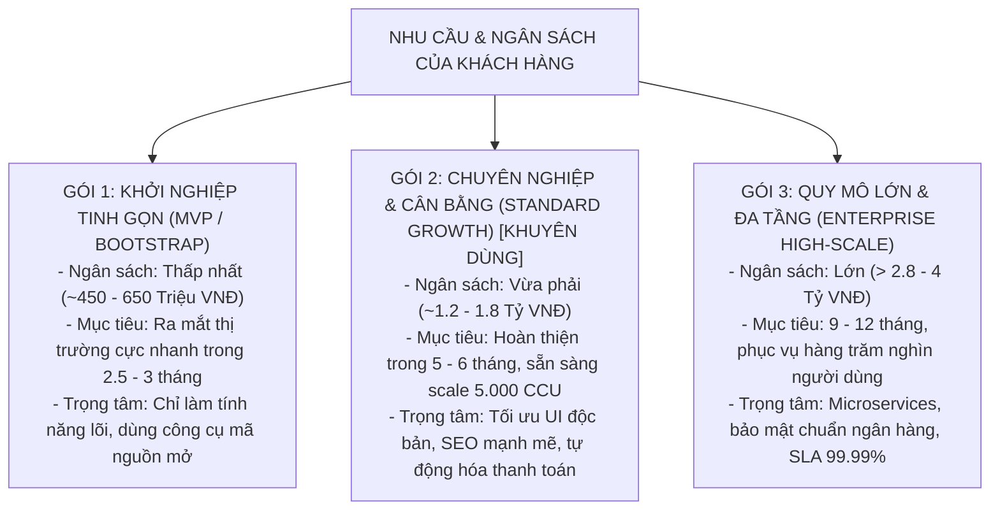

# 00. ĐỀ XUẤT CÁC PHƯƠNG ÁN TRIỂN KHAI, BÀI TOÁN CHI PHÍ & LỰA CHỌN CÔNG CỤ
## (PRE-IMPLEMENTATION PROPOSAL: COST-BENEFIT OPTIONS & ADAPTIVE TOOLING)

> **Nguyên tắc vàng của Quản trị dự án & Phân tích:** *"Trước khi đưa dự án vào triển khai thực tế, PM và BA bắt buộc phải trình bày cho Khách hàng/Ban Giám Đốc ít nhất 2 - 3 phương án giải pháp. Khách hàng phải nhìn thấy rõ ràng: Với túi tiền này thì nhận được gì, thời gian bao lâu, và bộ công cụ sử dụng là gì. Không bao giờ ép buộc một bộ công cụ cứng nhắc mà phải 'may đo' linh hoạt đúng theo nhu cầu và ngân sách của khách hàng!"*

---

## 1. So Sánh 3 Gói Phương Án Triển Khai & Chi Phí (Cost & Scope Packages)

PM và BA phân tích và xây dựng sẵn 3 gói giải pháp để Khách hàng lựa chọn theo bài toán kinh tế của họ:



---

## 2. Bảng Đối So Sánh Chi Tiết 3 Phương Án

| Tiêu Chí So Sánh | Gói 1: MVP Tinh Gọn (Lean) | Gói 2: Chuyên Nghiệp (Standard) **[LỰA CHỌN MẪU]** | Gói 3: Doanh Nghiệp Lớn (Enterprise) |
|---|---|---|---|
| **Tổng ngân sách nhân sự** | **~480.000.000 VNĐ** | **~1.477.500.000 VNĐ** | **~3.200.000.000 VNĐ** |
| **Chi phí hạ tầng Cloud / tháng** | **~$35 - $50 USD / tháng** (~900k - 1.3 triệu) | **~$85 - $120 USD / tháng** (~2.1 - 3 triệu) | **~$500 - $1.200 USD / tháng** (~13 - 30 triệu) |
| **Thời gian ra mắt (Time-to-market)**| **10 - 12 tuần (Khoảng 2.5 tháng)** | **24 tuần (6 tháng)** | **36 - 48 tuần (9 - 12 tháng)** |
| **Đội ngũ nhân sự tối thiểu** | 4 người (1 PM/BA, 1 FE, 1 BE, 1 QA/DevOps) | 10 người (Đầy đủ 9 bộ phận chuyên trách) | 16 - 22 người (Nhiều Squad tính năng độc lập) |
| **Quy mô người dùng đồng thời** | Đáp ứng 500 - 1.000 CCU | Đáp ứng **5.000 CCU** | Đáp ứng 50.000 - 100.000 CCU |
| **Mức độ tùy biến giao diện** | Tận dụng UI Kit có sẵn (Tailwind/Shadcn) | **Thiết kế UI độc bản trên Figma, cuộn 60fps** | Hệ thống Design System đa nền tảng riêng biệt |
| **Khả năng SEO Google** | SEO cơ bản | **SEO thống trị (Next.js SSR + Schema JSON-LD)** | Hệ sinh thái SEO đa vùng, đa ngôn ngữ |

---

## 3. Khung Đề Xuất Bộ Công Cụ (Toolstack) "May Đo" Theo Từng Khách Hàng

PM và BA tuyệt đối không áp dụng máy móc cùng một bộ công cụ cho mọi đối tượng khách hàng. Bộ công cụ được đề xuất dựa trên 3 tiêu chí: **Ngân sách**, **Độ gấp về tiến độ**, và **Môi trường vận hành**:

### Ma Trận Lựa Chọn Công Cụ Linh Hoạt:

```
[Khách hàng Ngân Sách Hạn Hẹp / Startup]
   ├── Quản lý dự án: Trello / Linear / ClickUp (Bản Free/Tiết kiệm)
   ├── Tài liệu: Notion / Google Docs
   ├── Hạ tầng: Cloud VPS Hetzner / DigitalOcean + Cloudflare Free
   └── CI/CD: GitHub Actions (Gói Free 2.000 phút/tháng)

[Khách hàng Doanh Nghiệp Tiêu Chuẩn (Dự án này)]
   ├── Quản lý dự án: Jira Software Cloud + Confluence
   ├── Thiết kế: Figma Professional Team
   ├── Hạ tầng: Hybrid VPS Cluster (Postgres Dedicated, Redis Cache, Nginx SSL)
   ├── CI/CD: GitHub Actions tự động hóa với Docker Multi-Stage
   └── Giám sát: Prometheus + Grafana + Sentry + Telegram Bot

[Khách hàng Ngân Hàng / Y Tế / Khắt Khe Bảo Mật]
   ├── Quản lý dự án: Jira Data Center On-Premise
   ├── Thiết kế & Vẽ luồng: Enterprise Architect / Lucidchart Enterprise
   ├── Hạ tầng: Máy chủ vật lý riêng biệt (Bare-metal) hoặc Private Cloud
   └── CI/CD: Cụm máy chủ Jenkins chạy trong mạng nội bộ (Air-Gapped)
```

---

## 4. Biên Bản Thống Nhất Phương Án & Chi Phí Trước Triển Khai (Pre-Implementation Sign-off)

Trước khi chuyển giao công việc cho đội ngũ Kỹ thuật (Designer, Dev, DBA, QA):
* **Đại diện Khách hàng / Chủ đầu tư:**
  - Xác nhận đã được tư vấn đầy đủ 3 gói giải pháp.
  - Lựa chọn chính thức: **GÓI 2 (CHUYÊN NGHIỆP & CÂN BẰNG)** với tổng hạn mức ngân sách: **1.850.000.000 VNĐ**.
  - Đồng thuận với bộ công cụ đề xuất: *Jira, Figma, Next.js, NestJS, PostgreSQL, Redis, GitHub Actions*.
* **Đại diện Ban Điều Hành Dự Án (Project Manager & Lead BA):**
  - Cam kết bám sát phạm vi (Scope), tiến độ 24 tuần và không phát sinh chi phí ngoài hạn mức quỹ dự phòng rủi ro.

*(Biên bản này là căn cứ pháp lý để mở Sprint 01 khởi động dự án)*

