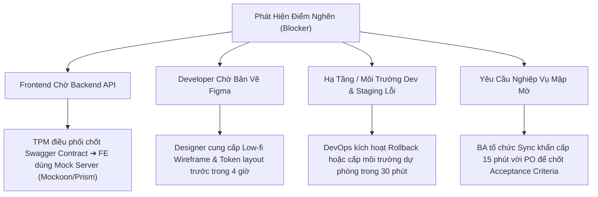

# QUY TRÌNH THÁO GỠ ĐIỂM NGHẼN & LEO THANG SỰ CỐ (BLOCKER RESOLUTION & ESCALATION)

## 1. Phân Loại Điểm Nghẽn Thường Gặp & Biện Pháp Xử Lý Tức Thì

---

## 2. Ma Trận Leo Thang Sự Cố (Escalation Matrix)

| Cấp Độ | Thời Gian Tồn Tại Điểm Nghẽn | Người Tiếp Nhận Xử Lý | Hành Động Bắt Buộc | Kênh Liên Lạc |
|---|---|---|---|---|
| **Level 1** | Dưới 2 giờ làm việc | Tech Lead / Module Owner | Trao đổi trực tiếp 1-1, tìm giải pháp tạm thời (workaround) | Slack DM, Kênh `#dev-internal` |
| **Level 2** | 2 đến 4 giờ làm việc | Project Coordinator / TPM | Tổ chức cuộc họp Standup khẩn cấp (Huddle), điều chuyển ưu tiên công việc của thành viên liên quan | Kênh `#project-blockers`, Tag @TPM |
| **Level 3** | Quá 4 giờ làm việc | Ban Giám Đốc / Project Sponsor | Báo cáo nguy cơ trễ Milestone, xin phê duyệt giải pháp thay thế hoặc điều chỉnh phạm vi Sprint | Email khẩn cấp + Gọi điện trực tiếp |

---

## 3. Biểu Mẫu Báo Cáo Điểm Nghẽn (Blocker Ticket Template)
* **Tiêu đề:** `[BLOCKER] - [Bộ phận bị nghẽn] - Mô tả ngắn gọn`
* **Người báo cáo:** [Tên người phát hiện]
* **Đối tượng gây nghẽn:** [Bộ phận/Cá nhân/Dịch vụ bên thứ ba]
* **Mức độ ảnh hưởng:** [Dừng toàn bộ Sprint / Dừng 1 tính năng / Chậm tiến độ]
* **Giải pháp đề xuất:** [Ý kiến đề xuất nếu có]

