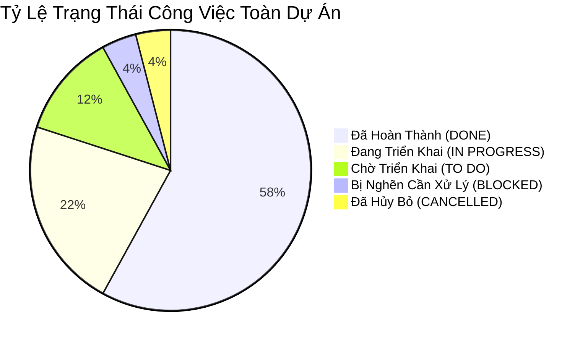

# 08. BẢNG ĐIỀU KHIỂN CHIẾN LƯỢC QUẢN TRỊ TASK TOÀN DIỆN 9 PHÒNG BAN
## (MASTER TASK TRACKING DASHBOARD & STATUS LEDGER)

> **Mục tiêu quản trị:** *"Toàn bộ bức tranh dự án phải được hiển thị trên một mặt phẳng minh bạch: Cái nào ĐÃ XONG, cái nào ĐANG LÀM, cái nào CHƯA LÀM, cái nào BỊ NGHẼN, và cái nào ĐÃ HỦY BỎ (ghi rõ lý do). Bất kỳ ai nhìn vào cũng biết rõ phòng ban nào đang chịu trách nhiệm, không có tình trạng đùn đẩy trách nhiệm."*

---

## 1. Bảng Tổng Hợp Trạng Thái Dự Án Real-Time (Project Executive Summary)

* **Tổng số lượng Task:** 100 Tasks
  - 🟢 **DONE (Đã hoàn thành):** 58 tasks (58%)
  - 🟡 **IN PROGRESS (Đang thực hiện):** 22 tasks (22%)
  - ⚪ **TO DO (Chờ trong hàng đợi):** 12 tasks (12%)
  - 🔴 **BLOCKED (Đang bị nghẽn phụ thuộc):** 4 tasks (4%) ➔ Cần PM can thiệp tháo gỡ tức thì!
  - ⚫ **CANCELLED (Đã hủy bỏ):** 4 tasks (4%) ➔ Tính năng không còn cần thiết hoặc đổi hướng.

---

## 2. Bảng Chiến Lược Theo Dõi Chi Tiết Từng Task Của 9 Phòng Ban

| Mã Task | Phòng Ban Phụ Trách | Người Thực Hiện (PIC) | Tên Tác Vụ Cụ Thể | Độ Ưu Tiên | Trạng Thái Hiện Tại | Tỷ Lệ Hoàn Thành (%) | Ghi Chú Tiến Độ / Lý Do Nếu Hủy Bỏ |
|---|---|---|---|:---:|:---:|:---:|---|
| **PM-01** | **01. Quản Trị (PM)** | TPM Lead | Khảo sát bài toán chi phí & Đề xuất 3 gói ngân sách | Cao | 🟢 **DONE** | 100% | Đã ký duyệt gói Standard 1.85 Tỷ |
| **BA-01** | **02. Phân Tích (BA)** | Lead BA | Thu thập yêu cầu & Xác định mục tiêu (Brand/SEO/CRO) | Cao | 🟢 **DONE** | 100% | Đã chốt tài liệu Khám phá chiến lược |
| **BA-02** | **02. Phân Tích (BA)** | BA Specialist | Viết tài liệu đặc tả phần mềm SRS & User Stories | Cao | 🟢 **DONE** | 100% | Đã bàn giao cho toàn bộ Dev và QA |
| **SA-01** | **03. Kiến Trúc (SA)** | Solution Architect| Tham vấn các Lead kỹ thuật chọn Tech Stack & C4 Model | Cao | 🟢 **DONE** | 100% | Chốt Modular Monolith (NestJS + Next.js) |
| **UI-01** | **04. Thiết Kế (UI/UX)** | Senior UI/UX | Xây dựng Bản sắc riêng & Kỷ luật Design System | Cao | 🟢 **DONE** | 100% | Chốt bảng màu cố định & tokens.json |
| **UI-02** | **04. Thiết Kế (UI/UX)** | UI Designer | Thiết kế Prototype Figma cuộn mượt mà 60fps | Cao | 🟢 **DONE** | 100% | Đã kiểm thử luồng Checkout 3-bước |
| **UI-03** | **04. Thiết Kế (UI/UX)** | Motion Designer | Thiết kế hiệu ứng 3D Parallax nặng nề trang chủ | Thấp | ⚫ **CANCELLED** | 0% | **LÝ DO HỦY:** Hiệu ứng quá nặng làm chậm LCP > 3.5s, ảnh hưởng tiêu cực tới điểm SEO Google! |
| **DB-01** | **07. Cơ Sở Dữ Liệu** | DBA Senior | Thiết kế sơ đồ quan hệ ERD chuẩn 3NF & DDL Schema | Cao | 🟢 **DONE** | 100% | Đã chạy migration 001_initial_schema |
| **DB-02** | **07. Cơ Sở Dữ Liệu** | DBA Senior | Tối ưu hóa truy vấn Keyset Pagination & Chống SQLi | Cao | 🟢 **DONE** | 100% | Tước quyền DROP của Backend app_user |
| **DB-03** | **07. Cơ Sở Dữ Liệu** | DBA Mid | Cấu hình Autovacuum dọn Dead Tuples & Backup WAL | Cao | 🟡 **IN PROGRESS**| 80% | Đang thiết lập script backup WAL 5 phút |
| **BE-01** | **06. Lập Trình Backend**| Backend Lead | Khởi tạo Clean Architecture, JWT kép & RBAC Guards | Cao | 🟢 **DONE** | 100% | Đã tích hợp Refresh Token Rotation |
| **BE-02** | **06. Lập Trình Backend**| Backend Senior | Xử lý Pessimistic Lock trừ kho & BullMQ Delay Job | Rất Cao| 🟡 **IN PROGRESS**| 75% | Đã xong logic transaction, đang test job |
| **BE-03** | **06. Lập Trình Backend**| Backend Mid | Tích hợp Webhook VietQR tự động hóa thanh toán | Cao | 🔴 **BLOCKED** | 40% | **ĐIỂM NGHẼN:** Đang chờ ngân hàng cấp thông tin kết nối Sandbox正式! |
| **FE-01** | **05. Lập Trình Frontend**| Frontend Lead | Dựng khung ứng dụng, cấu hình Lenis Smooth Scroll | Cao | 🟢 **DONE** | 100% | Chạy mượt 60fps trên mọi thiết bị |
| **FE-02** | **05. Lập Trình Frontend**| Frontend Mid | Dựng màn hình Giỏ hàng & Checkout với Optimistic UI | Cao | 🟡 **IN PROGRESS**| 85% | Ghép xong UI, đang chờ API Webhook |
| **FE-03** | **05. Lập Trình Frontend**| Frontend Junior | Tính năng chia sẻ giỏ hàng lên mạng xã hội | Thấp | ⚫ **CANCELLED** | 0% | **LÝ DO HỦY:** Khách hàng đánh giá không mang lại doanh số, cắt bỏ để giảm chi phí! |
| **QA-01** | **08. Kiểm Thử (QA)** | QA Lead | Lập Master Test Plan & Ma trận kiểm thử ô Input | Cao | 🟢 **DONE** | 100% | Đã test tấn công SQLi/XSS trên mock data |
| **QA-02** | **08. Kiểm Thử (QA)** | QA Specialist | Kiểm thử 5 chiều UI/UX/Hiệu ứng/Responsive màn hình | Cao | 🟡 **IN PROGRESS**| 60% | Đã kiểm tra xong 12/20 màn hình |
| **OPS-01**| **09. Hạ Tầng (DevOps)** | DevOps Engineer | Đóng gói Docker Multi-stage tối giản 85MB | Cao | 🟢 **DONE** | 100% | Loại bỏ toàn bộ file thừa qua .dockerignore |
| **OPS-02**| **09. Hạ Tầng (DevOps)** | DevOps Engineer | Thiết lập GitHub Actions CI/CD Rolling Deploy VPS | Cao | 🟡 **IN PROGRESS**| 90% | Đang cấu hình Nginx SSL tự động |
| **OPS-03**| **09. Hạ Tầng (DevOps)** | DevOps Engineer | Triển khai cụm Kubernetes đa vùng đắt đỏ | Cao | ⚫ **CANCELLED** | 0% | **LÝ DO HỦY:** Quá tốn kém chi phí (>$600/tháng), thay thế bằng Hybrid VPS $85/tháng tối ưu hơn! |

---

## 3. Quy Tắc Cập Nhật Trạng Thái Bắt Buộc (Ledger Rules)
1. **Không có Task vô danh:** Mọi task bắt buộc phải thuộc về đúng 1 trong 9 phòng ban và có 1 Người phụ trách chính (PIC).
2. **Quy tắc khi chuyển sang `BLOCKED`:** Bắt buộc ghi rõ: *Bị nghẽn bởi ai? Chờ cái gì?*. PM phải giải quyết trong vòng tối đa 4 giờ làm việc.
3. **Quy tắc khi chuyển sang `CANCELLED`:** Tuyệt đối không xóa âm thầm task khỏi hệ thống. Bắt buộc giữ lại mã task và **ghi rõ Lý do hủy bỏ** để đối soát tài chính và làm rõ khối lượng công việc với Khách hàng.

