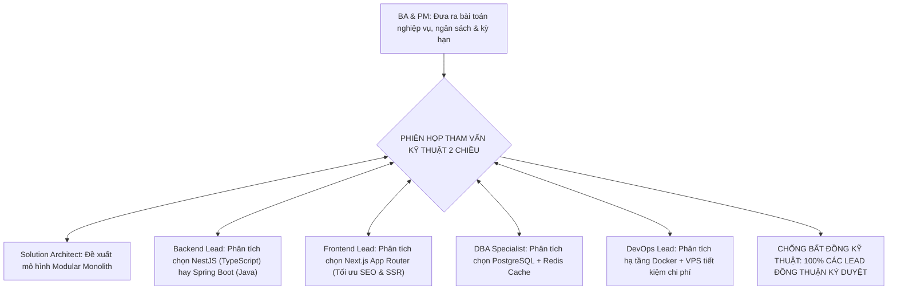

# 09. PHỐI HỢP LIÊN PHÒNG BAN TRƠN TRU, CÂN BẰNG TẢI & CHIẾN LƯỢC TIẾT KIỆM TOKEN
## (CROSS-DEPARTMENT WORKFLOW, WORKLOAD BALANCING & TOKEN EFFICIENCY)

> **Mục tiêu tối thượng:** *"Một cỗ máy chỉ vận hành trơn tru khi các bánh răng khớp nhau hoàn hảo. PM và BA là người điều phối nhịp nhàng: Không để phòng ban nào bị quá tải hay bị bỏ quên, phối hợp cùng các Lead kỹ thuật để chọn đúng công nghệ, bẻ nhỏ yêu cầu mạch lạc, và áp dụng chiến lược 'Siêu tiết kiệm Token' khi làm việc với AI và tài liệu."*

---

## 1. Cơ Chế Tham Vấn Kỹ Thuật 2 Chiều: Chọn Mô Hình & Ngôn Ngữ Triển Khai
PM và BA **tuyệt đối không được tự ý quyết định ngôn ngữ hay hạ tầng từ trên trời rơi xuống**, mà bắt buộc tổ chức phiên họp **Hội Đồng Kiến Trúc Kỹ Thuật (Architecture & Tech Stack Review)** trước khi triển khai:



---

## 2. Quy Trình Phân Rã Yêu Cầu (Requirement Decomposition Matrix)

Từ 1 mong muốn kinh doanh lớn của Khách hàng, BA và PM bẻ rã thành công việc cụ thể cho từng phòng ban, đảm bảo **không ai bị bỏ sót và không ai bị nghẽn việc**:

```
[BÀI TOÁN LỚN]: "Khách hàng muốn mua hàng và thanh toán VietQR tự động trong 3 giây"
      │
      ├──> [04. UI/UX Designer]: Thiết kế màn hình mã QR động, đồng hồ 10 phút, trạng thái loading (Figma)
      ├──> [07. Database Team]: Thiết kế bảng `orders`, `order_items`, `payments` và Pessimistic Lock tồn kho
      ├──> [06. Backend Dev]: Viết API `POST /orders/checkout`, tích hợp BullMQ delay job hoàn kho, Webhook IPN
      ├──> [05. Frontend Dev]: Dựng giao diện Checkout, kết nối API qua Axios Interceptor, hiển thị VietQR
      ├──> [08. QA / QC Team]: Viết kịch bản test tấn công SQLi/XSS vào ô địa chỉ, test thanh toán bằng Mock data
      └──> [09. DevOps Team]: Cấu hình WebSocket Reverse Proxy trên Nginx, mở port an toàn và giám sát Prometheus
```

---

## 3. Chiến Lược "Siêu Tiết Kiệm Token" Khi Vận Hành Dự Án Với AI (Token-Optimization Strategy)

Khi dự án sử dụng các trợ lý trí tuệ nhân tạo (AI Agents) để hỗ trợ lập trình, phân tích và quản lý, việc nhồi nhét tài liệu dài dòng sẽ gây lãng phí hàng triệu token và làm AI bị phân tâm (Context Drift). PM và BA ban hành **4 quy tắc tiết kiệm Token tối đa**:

1. **Module hóa tài liệu (Modular Context):**
   * Mỗi phòng ban chỉ nạp đúng file tài liệu của mình. Backend chỉ cần nạp tài liệu API và ERD; Frontend chỉ cần nạp Design Tokens và OpenAPI schema. Tuyệt đối không nạp toàn bộ mã nguồn của cả dự án vào 1 câu prompt.
2. **Chuẩn hóa Hợp đồng giao tiếp (Schema-First Contracts):**
   * Thay vì giải thích bằng lời văn dài hàng ngàn từ gây tốn token, BA và Tech Lead chỉ cần cung cấp định dạng **JSON Schema** hoặc **TypeScript Interface**. AI hiểu ngay lập tức cấu trúc dữ liệu chỉ với 50 tokens!
3. **Sử dụng bảng biểu và sơ đồ rút gọn (Mermaid & Markdown Tables):**
   * Một bảng ma trận hoặc sơ đồ Mermaid 20 dòng truyền tải lượng thông tin bằng 5 trang văn bản thông thường, tiết kiệm đến **80% chi phí Token**.
4. **Quy tắc Mock Server giải phóng phụ thuộc:**
   * Frontend chạy file `mock_api_server.js` độc lập để test giao diện mà không cần chờ Backend, không cần AI phải sinh đi sinh lại dữ liệu giả lập trong context chat.

---

## 4. Cân Bằng Tải Nhân Lực: Chống Hiện Tượng "Chỗ Ngồi Chơi, Chỗ Cháy Việc"

| Tuần Dự Án | 02. BA & PM | 04. UI/UX | 07. DBA | 06. Backend | 05. Frontend | 08. QA/QC | 09. DevOps |
|:---:|:---:|:---:|:---:|:---:|:---:|:---:|:---:|
| **Tuần 1 - 2** | 🔥 100% (Khảo sát, BRD) | 🟡 30% (Research) | ⚪ 10% (Tư vấn) | ⚪ 10% (Tư vấn) | ⚪ 10% (Tư vấn) | ⚪ 10% (Họp DoR) | 🟡 40% (Setup Git) |
| **Tuần 3 - 4** | 🟡 50% (SRS, AC) | 🔥 100% (Figma UI) | 🔥 90% (ERD, DDL)| 🟡 40% (Base API)| 🟡 30% (Base UI) | 🟡 50% (Test Plan)| 🔥 80% (CI/CD) |
| **Tuần 5 - 16**| 🟢 30% (Refine) | 🟢 40% (Support) | 🟡 60% (Tune SQL)| 🔥 100% (Core API)| 🔥 100% (Core UI)| 🔥 100% (Test Sp)| 🟢 40% (Maintain) |
| **Tuần 17 - 20**| 🟢 20% (UAT plan) | 🟢 20% (Refine) | 🟡 50% (Audit) | 🟡 60% (Fix bugs)| 🟡 60% (Fix bugs)| 🔥 100% (E2E/Load)| 🔥 80% (Staging) |
| **Tuần 21 - 24**| 🔥 90% (Bàn giao) | 🟢 10% (Done) | 🟡 70% (Backup) | 🟢 30% (On-call) | 🟢 30% (On-call) | 🔥 90% (Sign-off)| 🔥 100% (Go-Live) |

*Ghi chú:* Nhịp sinh học được phân bổ dạng bậc thang gối đầu. Khi một phòng ban hạ nhiệt ở pha này, họ sẽ đóng vai trò hỗ trợ thẩm định (Review) cho phòng ban đang ở tâm điểm cao trào, đảm bảo **toàn bộ 10 - 12 thành viên luôn có khối lượng công việc cân bằng, không ai bị kiệt sức (Burnout)**.

