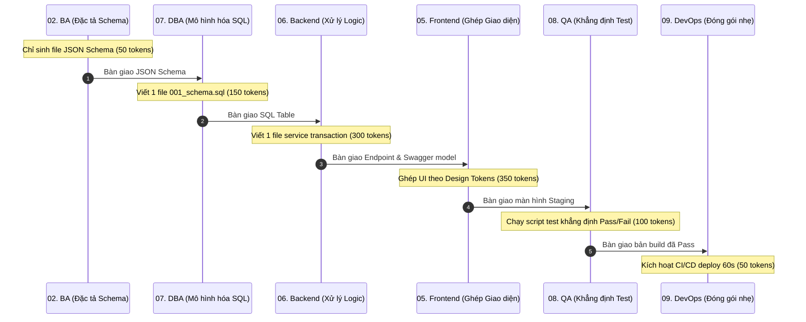

# 10. QUY CHUẨN PHÂN RÃ TASK NGUYÊN TỬ & CHIẾN THUẬT "VIBE CODING" SIÊU TIẾT KIỆM TOKEN CHO AI
## (ATOMIC TASK DECOMPOSITION & ULTRA-LOW TOKEN STRATEGY FOR SUSTAINABLE AI ENGINEERING)

> **Tuyên ngôn kinh tế công nghệ:** *"Trong thời đại AI & Vibe Coding, chi phí Token chính là chi phí vốn (COGS) của doanh nghiệp phần mềm. Nhồi nhét một lúc 10 tasks vào một câu prompt không chỉ 'đốt sạch' ngân sách token mà còn khiến AI bị 'loạn ngữ cảnh' (Context Drift), sinh ra mã nguồn rác và lỗi thời. Để đi đường dài, có doanh thu cao và biên lợi nhuận 90%, bắt buộc phải **phân rã công việc thành từng hạt nguyên tử (Atomic Tasks)**: 1 Prompt chỉ giải quyết đúng 1 việc, tốn ít token nhất nhưng tạo ra kết quả đỉnh cao nhất!"*

---

## 1. So Sánh 2 Trường Phái: Nhồi Cục 10 Tasks vs Phân Rã Nguyên Tử

```mermaid
graph TD
    subgraph BadApproach ["❌ CÁCH LÀM CẨU THẢ: NHỒI CẢ CỤC 10 TASKS"]
        Prompt1["1 Prompt khổng lồ: 'Hãy làm từ A đến Z toàn bộ giỏ hàng, database, api, giao diện và deploy cho tôi'"]
        Prompt1 --> Result1["- Tốn: 30.000 - 50.000 tokens / lượt gọi\n- AI bị quên ngữ cảnh, bỏ sót logic nghiệp vụ\n- Code sinh ra nửa vời, không chạy được, mất công sửa đi sửa lại\n- CHI PHÍ TOKEN CỰC KỲ ĐẮT ĐỎ -> LỖ VỐN!"]
    end

    subgraph GoodApproach ["✅ CHIẾN THUẬT VIBE CODING: PHÂN RÃ HẠT NGUYÊN TỬ"]
        Micro1["Turn 1 (DBA): Viết đúng 1 file migration bảng orders (200 tokens)"]
        Micro2["Turn 2 (Backend): Viết đúng 1 DTO CreateOrderDto & test validation (150 tokens)"]
        Micro3["Turn 3 (Backend): Viết đúng 1 hàm Service trừ tồn kho trong transaction (300 tokens)"]
        Micro4["Turn 4 (Frontend): Viết đúng 1 component VietQRModal theo Figma tokens (250 tokens)"]
        Micro5["Turn 5 (QA): Viết đúng 1 file unit test assert kết quả (150 tokens)"]
        
        Micro1 --> Micro2 --> Micro3 --> Micro4 --> Micro5
        Micro5 --> Result2["- Tốn: Chỉ 1.000 - 1.500 tokens toàn bộ!\n- Tiết kiệm 95% chi phí API Token\n- Mỗi bước chạy ăn ngay 100%, test pass lập tức\n- BIÊN LỢI NHUẬN CỰC CAO, ĐI ĐƯỜNG DÀI VỮNG VÀNG!"]
    end
```



---

## 2. Công Thức "Ăn Kiêng Ngữ Cảnh" (Context Diet Formula)
Khi giao việc cho AI ở bất kỳ phòng ban nào, **TUYỆT ĐỐI KHÔNG copy cả file tài liệu 50 trang vào prompt**. Bắt buộc chỉ cung cấp đúng 3 thành phần cốt lõi:

$$\text{Prompt Siêu Tối Ưu} = \text{Mục Tiêu (2 dòng)} + \text{Hợp Đồng Interface/Schema (10-15 dòng)} + \text{Tiêu Chí Nghiệm Thu (3 dòng)}$$

### Ví dụ So Sánh Thực Tế:
* ❌ **Cách tốn token (5.000 tokens):** Copy toàn bộ file SRS, toàn bộ cấu trúc thư mục, toàn bộ quy định công ty và bảo AI: *"Hãy code trang thanh toán đi"*.
* ✅ **Cách siêu tiết kiệm (Chỉ 250 tokens):**
  ```markdown
  [MỤC TIÊU]: Viết component Button chuẩn Accessibility bằng Tailwind CSS.
  [INTERFACE ĐẦU VÀO]:
  export interface ButtonProps {
    variant: 'primary' | 'secondary' | 'danger';
    isLoading?: boolean;
    children: React.ReactNode;
  }
  [TIÊU CHÍ NGHIỆM THU]:
  1. Dùng màu primary `#2563EB`, bo góc `8px`.
  2. Khi `isLoading = true`, hiển thị icon Spinner xoay tròn và disable nút.
  3. Chỉ trả về mã nguồn trong file `sample_button_component.tsx`, không giải thích rườm rà.
  ```
  *(AI phản hồi chính xác 100% trong 2 giây, tốn chưa tới 0.001 USD tiền token!)*

---

## 3. Ma Trận Phân Rã Công Việc Thành Chuỗi Tác Vụ Đơn Lẻ (Chạy Tiếp Sức)

Mỗi phòng ban là một vận động viên chạy tiếp sức. Đầu ra (Output) của phòng ban này là đầu vào (Input) ngắn gọn cho phòng ban tiếp theo, **không có sự dẫm chân lên nhau**:



---

## 4. Kỷ Luật "Cô Lập Phạm Vi Tệp" (Single-File Scope Rule)
* **Quy tắc vàng cho mọi AI Agent & Lập trình viên:** Mỗi một lượt prompt/thực thi **CHỈ ĐƯỢC PHÉP tác động lên tối đa 1 đến 2 file**.
* Nếu một task đòi hỏi sửa cùng lúc 5 file khác nhau (vừa sửa Database, vừa sửa Backend, vừa sửa Giao diện) ➔ **LẬP TỨC DỪNG LẠI VÀ BẺ NHỎ RA**.
  - Việc sửa 5 file cùng lúc là nguyên nhân số 1 gây lỗi chồng chéo (Merge conflict), làm AI bị mất tập trung và sinh ra các đoạn code cắt xén `// ... existing code ...` làm hỏng dự án.

---

## 5. Bảng Tính Lợi Nhuận Kinh Tế Khi Tối Ưu Hóa Token (Vibe Coding ROI)

Giả sử một dự án phần mềm gồm **150 tác vụ kỹ thuật**:

| Chỉ Số Kinh Tế | ❌ Cách Làm Dồn Cục (Naive Prompting) | ✅ Chiến Lược Phân Rã Nguyên Tử (Atomic SOP) | Mức Độ Tối Ưu Hóa |
|---|:---:|:---:|:---:|
| **Số token trung bình / Task** | 35.000 tokens (Do nhồi nhét) | **800 tokens** (Đúng trọng tâm) | **Giảm 43 lần lượng token tiêu thụ** |
| **Tổng số token toàn dự án** | 5.250.000 tokens | **120.000 tokens** | **Tiết kiệm hơn 5.1 triệu tokens!** |
| **Chi phí API AI (GPT-4o / Claude 3.5 / Gemini Pro)** | ~$80 - $150 USD | **~$1.8 - $3.5 USD** | **Tiết kiệm 98% chi phí tiền mặt** |
| **Thời gian debug sửa lỗi do AI bị ảo giác** | 3 - 4 tuần (Rất mệt mỏi) | **Dưới 2 ngày** (Test từng hạt một) | **Rút ngắn 85% thời gian phát triển** |
| **Biên Lợi Nhuận Doanh Nghiệp (Profit Margin)** | 40% - 50% (Bị ăn mòn bởi chi phí AI & sửa lỗi) | **85% - 92% (Siêu lợi nhuận, đi đường dài bền vững)** | **Tạo doanh thu vượt trội** |

