# 12. QUY CHUẨN VẬN HÀNH PRODUCTION & PHỐI HỢP KỸ THUẬT GIỮA 9 PHÒNG BAN DƯỚI SỰ QUẢN TRỊ CỦA ADMIN
## Production Readiness, Administrative Governance & Atomic Cross-Department Orchestration

> **TÔN CHỈ VẬN HÀNH:**
> 1. **Admin là người ra quyết định tối cao:** Toàn bộ ngân sách, token AI Vibe và tài nguyên hạ tầng do Admin đầu tư và điều phối. Mọi chỉ đạo từ Admin (`Admin Directives`) là mệnh lệnh tuyệt đối, được phân luồng qua **01. Quản Trị Dự Án (PM)** để bóc tách thành các tác vụ hạt nguyên tử (Atomic Tasks) điều phối xuống các phòng ban kỹ thuật.
> 2. **Khách hàng là đối tượng phục vụ & nghiệm thu:** Khách hàng chỉ truy cập qua **Cổng Khách Hàng (Client Portal)** và **Không Gian Dự Án Khách Hàng (Client Workspace)** bằng Mã Khóa Bảo Mật (Project Access Key). Khách hàng **tuyệt đối không được can thiệp vào mã nguồn, cấu hình phòng ban hay token AI của Admin**, mà chỉ đóng góp ý kiến qua Hộp Thư Phản Hồi (Feedback Intake).
> 3. **Phối hợp chuẩn xác theo chuỗi Handoff (Không nhảy cóc):** Không phòng ban nào được tự tiện thay đổi code, database hay hạ tầng mà bỏ qua khâu kiểm soát của SA, DBA và nghiệm thu QA.
> 4. **Ngôn ngữ chuyển ngữ 2 chiều (Dual-Perspective Translation):** Phòng ban kỹ thuật ghi nhận log chi tiết (Technical Log), nhưng khi báo cáo lên Admin và hiển thị cho Khách hàng bắt buộc phải chuyển ngữ sang **Ngôn ngữ kinh doanh dễ hiểu (Business-Friendly Perspective)**, giải thích rõ giá trị mang lại cho người dùng, loại bỏ các thuật ngữ gây bối rối.
> 5. **Bảo vệ an toàn thông tin khách hàng là sinh mệnh:** Tuyệt đối không để lộ dữ liệu cá nhân (tên, ngày sinh, số điện thoại) ra bên ngoài. Khóa truy cập phải được mã hóa chữ ký số HMAC-SHA và bảo vệ toàn vẹn.

---

### 1. BẢN ĐỒ PHÂN CHIA NHIỆM VỤ & TRÁCH NHIỆM CỤ THỂ CỦA 9 PHÒNG BAN

```mermaid
flowchart TD
    Admin["👑 BAN QUẢN TRỊ (ADMIN MASTER)\n(Ra quyết định, cấp key, điều phối ngân sách & AI Vibe)"]
    Client["💼 KHÁCH HÀNG / SPONSOR\n(Gửi Feedback, xem thử Web Động, nghiệm thu)"]
    
    Admin ==>|"Phát lệnh chỉ đạo điều phối"| PM["01. QUẢN TRỊ DỰ ÁN (PM/TPM)\n• Tiếp nhận chỉ đạo & feedback\n• Bóc tách Atomic Task siêu tiết kiệm Token\n• Gỡ nghẽn Blocker & kiểm soát tiến độ"]
    Client ==>|"Hộp thư Feedback"| PM
    
    subgraph Discovery ["GIAI ĐOẠN 1: KHỞI TẠO & PHÂN TÍCH"]
        BA["02. PHÂN TÍCH NGHIỆP VỤ (BA)\n• Chuyển hóa ý tưởng thành SRS & User Stories\n• Luồng nghiệp vụ BPMN dễ hiểu\n• Bảo mật thông tin kinh doanh"]
    end
    
    subgraph Architecture ["GIAI ĐOẠN 2: THIẾT KẾ & KIẾN TRÚC"]
        SA["03. KIẾN TRÚC & CHI PHÍ (SA)\n• Tech Stack chuẩn Clean Architecture\n• Tối ưu chi phí FinOps Local vs VPS vs Prod\n• Quản trị rủi ro & giải pháp dự phòng"]
        UIUX["04. THIẾT KẾ TRẢI NGHIỆM (UI/UX)\n• Design System chuẩn Brand Guideline\n• Tuyệt đối không dùng emoji/icon màu mè tùy tiện\n• Tối ưu cuộn mượt 60fps trên Mobile (390px)"]
    end
    
    subgraph Implementation ["GIAI ĐOẠN 3: LẬP TRÌNH & CSDL"]
        DBA["07. CƠ SỞ DỮ LIỆU (DBA)\n• Schema DDL, Migration & Seeding\n• Kỷ luật Index thép chống phình đĩa\n• Phân vùng Partitioning & WAL Backup"]
        BE["06. LẬP TRÌNH BACKEND (BE)\n• REST APIs, Swagger, Idempotency\n• Tích hợp VietQR thật & Webhook IPN\n• Khóa bi quan (Pessimistic Lock) chống lỗi số dư"]
        FE["05. LẬP TRÌNH FRONTEND (FE)\n• Web Động React/Next.js thời gian thực\n• Responsive không vỡ font, không tràn viền\n• Tương tác giỏ hàng & thanh toán dưới 1s"]
    end
    
    subgraph Verification ["GIAI ĐOẠN 4: KIỂM ĐỊNH & THẨM ĐỊNH"]
        QA["08. KIỂM ĐỊNH CHẤT LƯỢNG (QA)\n• Test chức năng & ghi nhật ký PASS/FAIL\n• Kiểm tra an ninh ô nhập liệu (Input Security)\n• Test tải k6 trên Sandbox Mock DB cô lập"]
    end
    
    subgraph Deployment ["GIAI ĐOẠN 5: TRIỂN KHAI & VẬN HÀNH"]
        DevOps["09. HẠ TẦNG & TRIỂN KHAI (DEVOPS)\n• Hỗ trợ Local LAN, VPS Cloud & Domain SSL\n• Đóng gói Docker siêu nhẹ < 85MB\n• Quản lý Secret Zero-Trust & Rollback 60s"]
        Prod["🚀 PRODUCTION LIVE 24/7\n• Tên miền riêng có SSL xanh\n• Dữ liệu thật 100%, ngân hàng thật\n• Uptime SLA 99.9%"]
    end

    PM --> BA
    BA --> SA
    BA --> UIUX
    SA --> DBA
    SA --> BE
    UIUX --> FE
    DBA --> BE
    BE --> FE
    BE --> QA
    FE --> QA
    QA --> DevOps
    DevOps --> Prod
```



---

### 2. BẢNG KIỂM TRA CHỨC TRÁCH & ĐẦU RA BẮT BUỘC CỦA TỪNG PHÒNG BAN

| STT | Phòng Ban | Người Phụ Trách (PIC) | Đầu Vào Tiếp Nhận (Inputs) | Đầu Ra Bàn Giao (Deliverables) | Tiêu Chí Nghiệm Thu (Acceptance Criteria) |
| :---: | :--- | :--- | :--- | :--- | :--- |
| **01** | **Quản Trị Dự Án (PM)** | TPM Lead | • Chỉ đạo từ Admin<br>• Feedback từ Khách hàng | • WBS phân rã chi tiết<br>• Atomic Tasks cho AI Vibe<br>• Báo cáo tiến độ & ngân sách | Task bẻ nhỏ hạt nguyên tử, tiết kiệm 95% token AI, kiểm soát tiến độ không chậm trễ. |
| **02** | **Phân Tích Nghiệp Vụ (BA)** | Lead BA | • Ý tưởng kinh doanh thô<br>• Nhu cầu người dùng | • Tài liệu SRS & User Stories<br>• Sơ đồ luồng BPMN | Ngôn từ trong sáng, dễ hiểu cho khách hàng; không dùng thuật ngữ công nghệ phức tạp gây bối rối. |
| **03** | **Kiến Trúc & Chi Phí (SA)** | Principal Architect | • SRS từ BA<br>• Hạn mức ngân sách Admin | • System Architecture Document (SAD)<br>• Bảng tính FinOps chi phí hạ tầng<br>• Phương án dự phòng (Fallbacks) | Kiến trúc chịu tải cao, chi phí máy chủ tối ưu minh bạch cho cả đôi bên. |
| **04** | **Thiết Kế Trải Nghiệm (UI/UX)** | Senior Product Designer | • User flow từ BA<br>• Brand Guideline của khách | • Design Tokens JSON<br>• Prototype Figma chuẩn thương hiệu<br>• Thông số cuộn 60fps Mobile | Tuyệt đối không dùng emoji/icon màu mè tùy tiện; bảng màu Navy tối giản sang trọng; cuộn mượt mà trên mobile view 390px. |
| **05** | **Lập Trình Frontend (FE)** | Frontend Lead | • Figma Prototype từ UI/UX<br>• Swagger APIs từ BE | • Mã nguồn Web Động React/Next.js<br>• Module giỏ hàng & Checkout VietQR | 100% Web Động, phản hồi thao tác dưới 1s, responsive không vỡ font, không tràn viền. |
| **06** | **Lập Trình Backend (BE)** | Backend Lead | • Schema DDL từ DBA<br>• SRS nghiệp vụ từ BA | • RESTful APIs chuẩn Clean Architecture<br>• Webhook IPN đối soát ngân hàng<br>• Khóa bi quan chống lỗi số dư | Xử lý an toàn, kiểm soát xung đột dữ liệu (Concurrency), tự động đối soát ngân hàng tức thời. |
| **07** | **Cơ Sở Dữ Liệu (DBA)** | DBA Specialist | • ERD từ SA/BA<br>• Quy chuẩn tải trọng | • Schema DDL & Migration Scripts<br>• Chiến lược Indexing chống phình đĩa<br>• Lịch Autovacuum & WAL Backup | Truy vấn báo cáo dưới 50ms, bảo vệ chống SQL Injection 100%, bảo mật phân quyền RLS. |
| **08** | **Kiểm Định Chất Lượng (QA)** | QA/QC Lead | • Bản build Staging từ Dev<br>• Bộ tiêu chí chấp nhận (AC) | • Nhật ký kiểm thử tính năng PASS/FAIL<br>• Ma trận kiểm định an ninh Input<br>• Biên bản nghiệm thu QA Sign-off | Kiểm thử toàn diện trên Sandbox Mock DB, xác thực mọi ô nhập liệu không dính XSS/Script Injection trước khi ký duyệt. |
| **09** | **Hạ Tầng & Triển Khai (DevOps)** | Cloud DevOps Engineer | • Bản build nghiệm thu từ QA<br>• Cấu hình biến môi trường .env | • Đường ống CI/CD tự động<br>• Docker Image dung lượng siêu nhẹ < 85MB<br>• Nginx Reverse Proxy & SSL TLS 1.3 | Hỗ trợ linh hoạt Local / VPS / Domain riêng có SSL xanh; cơ chế Rollback an toàn dưới 60s. |

---

### 3. QUY TRÌNH PHỐI HỢP KHI NHẬN CHỈ ĐẠO TỪ ADMIN (ADMIN DIRECTIVE DISPATCH PROTOCOL)

Khi Admin phát lệnh chỉ đạo điều phối từ Admin Dashboard (`dispatchModal`):

```
[ADMIN MASTER PHÁT LỆNH ĐIỀU PHỐI]
               │
               ▼
   [01. PM TIẾP NHẬN ĐẦU MỐI]
   • Xác thực thẩm quyền Admin Master Key.
   • Đánh giá mức độ ưu tiên & bóc tách thành các Atomic Tasks mang mã [DIR-xxx].
   • Gắn tag "CHỈ ĐẠO BAN QUẢN LÝ" vào bảng nhiệm vụ.
               │
               ├─────────────────────────────────────────┐
               ▼                                         ▼
   [Nhiệm vụ Kiến trúc & Giao diện]          [Nhiệm vụ Backend & Cơ sở dữ liệu]
   • SA: Cập nhật ADR kiến trúc.             • DBA: Tạo Migration script an toàn.
   • UI/UX: Hiệu chỉnh Design Token & Layout.• BE: Lập trình API & xử lý Transaction.
               │                                         │
               └────────────────────┬────────────────────┘
                                    ▼
                         [05. FRONTEND TÍCH HỢP]
                         • Ghép nối giao diện Web Động.
                         • Đảm bảo Responsive chuẩn xác trên mọi thiết bị.
                                    │
                                    ▼
                         [08. QA KIỂM THỬ KHÉP KÍN]
                         • Thực thi test case kiểm tra tiêu chí của Admin.
                         • Xác nhận PASS không phát sinh lỗi hồi quy (Regression).
                                    │
                                    ▼
                         [09. DEVOPS RELEASE / ROLLBACK]
                         • Triển khai bản build an toàn lên Staging/Production.
                         • Gửi báo cáo hoàn tất thời gian thực về Admin Dashboard.
```

---

### 4. QUY TRÌNH TIẾP NHẬN FEEDBACK KHÁCH HÀNG & PHẢN HỒI KỸ THUẬT

1. **Khách hàng gửi ý kiến từ Client Workspace:**
   - Ý kiến được lưu trữ an toàn, chuyển thẳng về **Cổng Tiếp Nhận Feedback** trên Admin Dashboard.
   - Nội dung được lọc sạch mã độc qua hàm `sanitizeInput()` và `escapeHtml()`.
2. **PM chủ trì phân tích Solution kỹ thuật an toàn:**
   - Tuyệt đối không để phòng ban tự ý trả lời qua loa cho khách.
   - PM phối hợp với SA và UI/UX để ban hành **Solution đề xuất chính thức**:
     - *Nếu phản hồi về giao diện (UI/UX):* Điều chỉnh lại màu sắc theo Brand Guideline, loại bỏ emoji, kiểm tra cuộn 60fps.
     - *Nếu phản hồi về chức năng:* Bổ sung kiểm thử, cập nhật Web Động kết nối VietQR chuẩn xác.
3. **Chuyển ngữ sang ngôn ngữ phi kỹ thuật cho khách hàng:**
   - Mọi tiến độ cập nhật trên Workspace của khách hàng phải dùng ngôn từ rõ ràng, tích cực, giải thích rõ kết quả mang lại cho công việc kinh doanh của khách, tuyệt đối không quăng mã lỗi kỹ thuật.

---

### 5. QUY CHUẨN XỬ LÝ SỰ CỐ TẮC NGHẼN (BLOCKER INCIDENT & FALLBACK WORKAROUND)

Khi một phòng ban gặp trở ngại từ đối tác bên ngoài (ví dụ: Ngân hàng bảo trì cổng Sandbox, đối tác cung cấp dịch vụ bên ngoài chậm phản hồi):

* **KỶ LUẬT 1: Không để dự án đứng yên.**
  Phòng ban gặp sự cố lập tức báo cáo PM và SA để kích hoạt **Giải Pháp Dự Phòng Nội Bộ (Internal Fallback / Sandbox Mock Server)**.
* **KỶ LUẬT 2: Bảo đảm trải nghiệm của Khách Hàng.**
  Trên giao diện của khách hàng, trạng thái hiển thị rõ:
  > *"✓ Hệ thống đang vận hành giải pháp thay thế tạm thời - Khách hàng kiểm thử bình thường, tiến độ bàn giao đảm bảo 100% không bị ảnh hưởng."*
* **KỶ LUẬT 3: Cập nhật lịch sử khắc phục (Audit Trail).**
  Khi đối tác xử lý xong, phòng ban hoàn tất tích hợp thật, cập nhật trạng thái đã giải quyết và Admin xác nhận đóng Blocker.

---

### 6. TIÊU CHUẨN MÔI TRƯỜNG PRODUCTION THỰC TẾ (REAL DATA GUARANTEE)

Để đảm bảo hệ thống sẵn sàng bàn giao cho khách hàng sử dụng thật trong kinh doanh:

1. **Không gian dữ liệu thật 100% (Production):**
   - Kết nối cổng thanh toán VietQR thật, khách hàng quét mã tiền về ngay tài khoản ngân hàng của chủ doanh nghiệp.
   - Danh mục sản phẩm, giá bán, tồn kho do Admin quản lý qua **Client CMS** trên Admin Hub và phản ánh dữ liệu thật.
   - Kết nối Tên Miền Riêng chính thức và kích hoạt chứng chỉ SSL xanh (HTTPS TLS 1.3).
2. **Không gian thử nghiệm độc lập (Local Sandbox / VPS Staging):**
   - Vận hành trên máy chủ cục bộ hoặc VPS thử nghiệm độc lập.
   - Dùng dữ liệu Sandbox cô lập để kiểm thử và đào tạo nhân viên của khách hàng trước khi chạy chính thức.
   - Bảo mật 100% thông tin kinh doanh và dữ liệu nhạy cảm của khách hàng.

---

**BAN QUẢN TRỊ DỰ ÁN (IT-ASSIGNMENT GOVERNANCE BOARD)**  
*Đã phê duyệt và ban hành áp dụng đồng bộ cho toàn bộ 9 phòng ban.*

