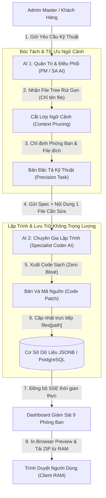

# QUY TRÌNH QUẢN TRỊ KIẾN TRÚC ZERO-LOAD & VIRTUAL CODE WORKSPACE
## DÀNH CHO PROJECT MANAGER & SYSTEM ARCHITECT (TIÊU CHUẨN PRODUCTION)

> [!IMPORTANT]
> **Nguyên tắc cốt lõi:** Khi hệ thống mở rộng phục vụ hàng nghìn dự án, máy chủ VPS tuyệt đối KHÔNG bao giờ được biến thành máy build mã nguồn cá nhân hay tải `node_modules` nặng hàng gigabyte. Toàn bộ mã nguồn dự án được quản trị dưới dạng **Virtual File Tree (JSONB)** thuần text trong Cơ Sở Dữ Liệu và RAM.

---

## 1. BẢNG SO SÁNH HIỆU NĂNG KIẾN TRÚC

| Tiêu Chí Đánh Giá | Mô Hình Truyền Thống (Cũ) | Mô Hình Zero-Load Virtual Code (Chuẩn Mới) |
| :--- | :--- | :--- |
| **Dung lượng mỗi dự án** | 300MB – 800MB (kèm `node_modules`) | **200KB – 500KB** (Thuần Text JSONB) |
| **Sức chứa trên 1GB RAM/Disk** | 2 – 5 dự án (nguy cơ OOM) | **2,000 – 5,000 dự án chạy song song** |
| **Tải CPU Máy Chủ** | 80% – 100% khi build/dev | **0% – 2% (Stateless API)** |
| **Xuất file mã nguồn** | Nén ổ đĩa sinh file rác | **Nén từ RAM (JSZip Stream) 0-byte Disk** |
| **Độ trễ AI phản hồi** | 30s – 60s (gửi cả dự án phình token) | **1s – 3s (Selective Context Pruning)** |

---

## 2. NGUYÊN TẮC HOẠT ĐỘNG CỦA 2 CON AI TRONG PHÒNG BAN



---

## 3. CHECKLIST KIỂM ĐỊNH CHO PM TRƯỚC KHI DUYỆT CODE

1. **Tuyệt đối không lưu thư mục `node_modules` hay file build tạm (`dist/`, `.next/`, `build/`) lên ổ cứng VPS.**
2. **Mỗi dự án lưu trữ dạng dictionary cấu trúc phẳng:**
   ```json
   {
     "package.json": "...",
     "src/App.jsx": "...",
     "src/components/Navbar.jsx": "...",
     "database/schema.sql": "..."
   }
   ```
3. **Mọi thao tác xuất mã nguồn phải dùng cơ chế nén trực tiếp từ RAM (`JSZip`) và bắn Stream về trình duyệt.**
4. **Việc render chạy thử (Live Preview) được đẩy toàn bộ về Client-side sử dụng bộ giả lập trình duyệt hoặc Sandbox.**
