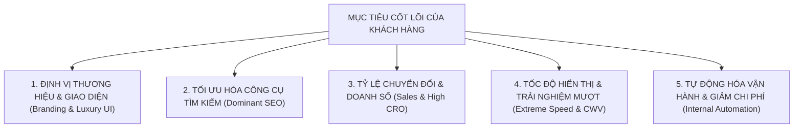

# 00. KHÁM PHÁ CHIẾN LƯỢC & ĐỊNH HƯỚNG MỤC TIÊU DỰ ÁN
## (STRATEGIC PROJECT DISCOVERY & CONSUMER INTENT ANALYSIS)

> **Tuyên ngôn cốt lõi:** *"Nếu ta dành 10 giờ để xây một hệ thống, hãy dành ít nhất 4 giờ đầu tiên để hiểu rõ: Khách hàng thực sự cần gì, người tiêu dùng mong muốn điều gì, và đâu là trọng tâm sống còn của dự án (Thương hiệu, Doanh số, SEO hay Tốc độ) trước khi viết dù chỉ một dòng code."*

---

## 1. Xác Định Chủ Đề & Lĩnh Vực Cốt Lõi Của Dự Án (Domain & Industry Theme)

Trước khi phân tích tính năng kỹ thuật, BA phải cùng Khách hàng/Sponsor chốt chính xác **Chủ đề (Theme) và Bản sắc lĩnh vực**:

| Hạng Mục Khảo Sát | Nội Dung Phân Tích Thực Tế | Ý Nghĩa Định Hướng Kỹ Thuật & Thiết Kế |
|---|---|---|
| **Lĩnh vực / Ngành hàng** | Thương mại điện tử B2C kết hợp trải nghiệm bán lẻ đa kênh (Omnichannel Retail) | Ảnh hưởng trực tiếp tới cấu trúc dữ liệu giỏ hàng, kho bãi và cổng thanh toán |
| **Phong cách & Tông giọng (Brand Tone & Voice)** | Hiện đại, Tinh tế, Đáng tin cậy, Minh bạch, Hướng tới giới trẻ công nghệ | Quyết định bảng màu UI (Xanh hoàng gia/Trắng sáng), phong cách viết chữ (Copywriting) trên từng nút bấm |
| **Định vị thị trường (Market Positioning)** | Phân khúc Trung - Cao cấp (Affordable Luxury / Premium Tech) | Giao diện phải toát lên sự chỉn chu, thoáng đãng, tuyệt đối tránh nhồi nhét banner giảm giá lòe loẹt như trang chợ xả hàng |

---

## 2. Bóc Tách 5 Trọng Tâm Mong Muốn Của Khách Hàng (Client's Primary Desires)

Khách hàng khi thuê hoặc yêu cầu làm phần mềm thường có nhiều mong muốn đan xen. BA có nhiệm vụ phân loại và xếp thứ tự ưu tiên (Priority Ranking) để định hướng cho toàn bộ 8 bộ phận còn lại:



### 🎯 Trọng Tâm 1: Mong muốn về Giao diện & Nhận diện Thương hiệu (UI/UX & Branding)
* **Nếu khách hàng coi đây là ưu tiên số 1:**
  - **Tác động tới UI/UX:** Cần tập trung ngân sách cho thiết kế độc bản (Custom Design), xây dựng Design System chỉn chu, hiệu ứng chuyển động vi mô (Micro-interactions) tinh tế, hình ảnh sắc nét chuẩn Retina.
  - **Tác động tới Frontend:** Tái hiện pixel-perfect, hỗ trợ chế độ Sáng/Tối (Dark/Light mode) mượt mà, Typography phân cấp thị giác mạnh mẽ.

### 🎯 Trọng Tâm 2: Mong muốn về SEO Mạnh & Thống Trị Tìm Kiếm (SEO Dominance)
* **Nếu khách hàng coi đây là ưu tiên số 1 (Ví dụ: Muốn leo Top 1 Google để có nguồn khách tự nhiên không tốn tiền quảng cáo Ads):**
  - **Tác động tới Kiến trúc & Backend/Frontend:** Bắt buộc áp dụng **Server-Side Rendering (SSR)** hoặc Static Site Generation (SSG) với **Next.js**. Tuyệt đối không dùng Single Page Application (SPA React thuần) vì con bot của Google/Facebook khó cào dữ liệu.
  - **Tác động tới Dữ liệu:** Tự động sinh `sitemap.xml`, `robots.txt`, thẻ Canonical URL, cấu trúc URL thân thiện (Friendly slug: `/dien-thoai-flagship-2026`).
  - **Tích hợp Dữ liệu có cấu trúc (Schema.org / JSON-LD):** Khai báo schema Sản phẩm, Đánh giá sao (Review), Giá tiền, Tình trạng còn hàng để Google hiển thị kết quả tìm kiếm dạng **Rich Snippets** (Có sao vàng và giá hiển thị ngay trên Google Search).

### 🎯 Trọng Tâm 3: Mong muốn về Tỷ Lệ Chuyển Đổi & Doanh Thu (High Conversion Rate - CRO)
* **Nếu mục tiêu là bán hàng tối đa:**
  - Quy trình Checkout phải rút ngắn tối đa: "1-Click Checkout" hoặc "Mua ngay" bỏ qua giỏ hàng.
  - Quét mã VietQR tự động khớp đơn trong 3 giây.
  - Tích hợp các yếu tố tạo niềm tin (Trust Badges): Chứng nhận bảo mật, chính sách đổi trả 7 ngày, cam kết chính hãng.

### 🎯 Trọng Tâm 4: Mong muốn về Tốc Độ & Chịu Tải (Speed & Scalability)
* Website tải dưới **1.5 giây** trên mạng di động 4G; điểm Google Lighthouse Performance đạt **95/100**.

---

## 3. Phân Tích Động Cơ & Tâm Lý Người Tiêu Dùng (Consumer Intent & Persona)

Người dùng cuối (End-Consumer) không quan tâm hệ thống viết bằng ngôn ngữ gì hay chạy server nào. Họ chỉ quan tâm hệ thống có giải quyết được **"Việc Cần Làm" (Jobs-To-Be-Done - JTBD)** của họ hay không:

### Bảng Phân Tích Tâm Lý Người Tiêu Dùng:

| Giai Đoạn Hành Trình | Ý Định Của Khách Hàng (Consumer Intent) | Rào Cản / Nỗi Sợ Tâm Lý (Friction & Anxiety) | Giải Pháp Thiết Kế Hệ Thống Cần Đạt |
|---|---|---|---|
| **1. Khám phá (Discovery)** | *"Tôi muốn xem nhanh các mẫu điện thoại mới nhất mà không bị bắt đăng nhập."* | Bị gián đoạn bởi popup bắt đăng ký nhận tin, trang tải chậm quá 3 giây. | Cho phép duyệt hàng tự do; tải trang cực nhanh; hiển thị bộ lọc thông minh (Hãng, Mức giá, Tính năng). |
| **2. Cân nhắc (Evaluation)** | *"Sản phẩm này có thực sự tốt không? Giá có bị đắt hơn nơi khác không?"* | Sợ hàng giả, sợ đánh giá ảo, thiếu thông tin thông số kỹ thuật chi tiết. | Hiển thị đánh giá có gắn nhãn *"Đã mua hàng thật"*; bảng so sánh thông số trực quan; video đập hộp. |
| **3. Ra quyết định (Decision)** | *"Tôi muốn đặt món này ngay, nhưng thanh toán có an toàn và tiện không?"* | Ngại nhập số thẻ tín dụng 16 số dài dòng; sợ lộ thông tin ngân hàng; sợ phí ship ẩn ở bước cuối. | Tích hợp mã VietQR động quét tức thì; hiển thị công khai phí ship ngay từ giỏ hàng. |
| **4. Sau khi mua (Post-Purchase)**| *"Tiền đã trừ trong tài khoản, hàng của tôi khi nào tới nơi?"* | Lo lắng không biết đơn hàng đã được xác nhận chưa, shipper đang ở đâu. | Bắn thông báo xác nhận tự động qua SMS/Zalo trong 3 giây; cung cấp màn hình tra cứu lộ trình vận chuyển real-time. |

---

## 4. Ma Trận Đánh Đổi Chiến Lược (Trade-Off Matrix)

Trong thực tế, các mong muốn thường xung đột với nhau. BA cần làm việc với Khách hàng để thiết lập **Nguyên tắc phân xử khi có xung đột (Conflict Resolution)**:

```
[Hiệu Ứng Giao Diện Nặng Nề / 3D Animation]  <--- XUNG ĐỘT --->  [Tốc Độ Tải Trang & Điểm SEO]
```
* **Nguyên tắc thống nhất:** Nếu hiệu ứng đồ họa làm chậm thời gian tải trang (LCP > 2.5s) hoặc ảnh hưởng điểm SEO của Google, **Ưu tiên Tốc độ tải và SEO hàng đầu**. Mọi animation phải được tối ưu bằng CSS thuần/Framer Motion nhẹ nhàng và tải ngầm (Lazy load) sau khi nội dung chính đã hiển thị.

