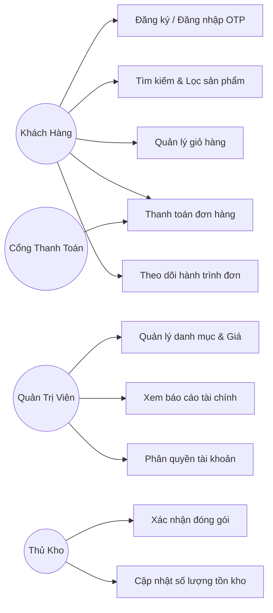

# TÀI LIỆU ĐẶC TẢ TRƯỜNG HỢP SỬ DỤNG (USE CASE SPECIFICATIONS)

## 1. Sơ Đồ Tổng Quan Use Case Hệ Thống

---

## 2. Đặc Tả Chi Tiết Use Case: UC04 - Thanh Toán Đơn Hàng

* **Tên Use Case:** UC04 - Thanh Toán Đơn Hàng Trực Tuyến
* **Tác nhân chính (Primary Actor):** Khách Hàng (Customer)
* **Tác nhân phụ (Supporting Actors):** Cổng Thanh Toán (Bank / VietQR Service), Hệ thống kho
* **Tiền điều kiện (Preconditions):**
  1. Người dùng đã đăng nhập hoặc cung cấp đủ thông tin nhận hàng hợp lệ.
  2. Giỏ hàng có ít nhất 1 sản phẩm còn hàng trong kho.
* **Hậu điều kiện thành công (Postconditions):**
  1. Đơn hàng chuyển sang trạng thái `Đã thanh toán`.
  2. Tồn kho sản phẩm được cập nhật chính xác.
  3. Tin nhắn/email xác nhận đơn hàng được gửi đi.
* **Luồng sự kiện chính (Main Success Scenario):**
  1. Khách hàng bấm "Thanh toán" tại màn hình Giỏ hàng.
  2. Hệ thống kiểm tra lại giá tiền, phí vận chuyển và mã giảm giá.
  3. Hệ thống tạo đơn hàng trạng thái `Chờ thanh toán` và sinh mã VietQR động.
  4. Khách hàng quét mã QR trên ứng dụng ngân hàng và hoàn tất chuyển khoản.
  5. Cổng thanh toán gửi Webhook thông báo thành công về máy chủ.
  6. Hệ thống cập nhật trạng thái đơn thành `Đã thanh toán` và hiển thị thông báo chúc mừng trên màn hình khách hàng.
* **Luồng rẽ nhánh & Ngoại lệ (Alternative & Exception Flows):**
  * **3a. Hết hàng trong kho:** Hệ thống cảnh báo sản phẩm đã hết, đề xuất khách hàng chọn kích cỡ khác và dừng quy trình.
  * **4a. Quá hạn thanh toán 10 phút:** Khách hàng không quét mã, hệ thống tự động hủy đơn và hoàn trả hàng về kho.
  * **5a. Webhook gửi trùng lặp:** Hệ thống nhận diện mã đối soát đã xử lý nhờ cơ chế Idempotent, lập tức trả về HTTP 200 OK mà không cộng dồn tiền hay trừ kho hai lần.

