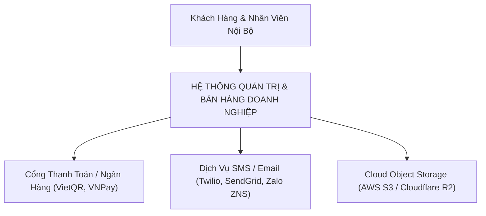
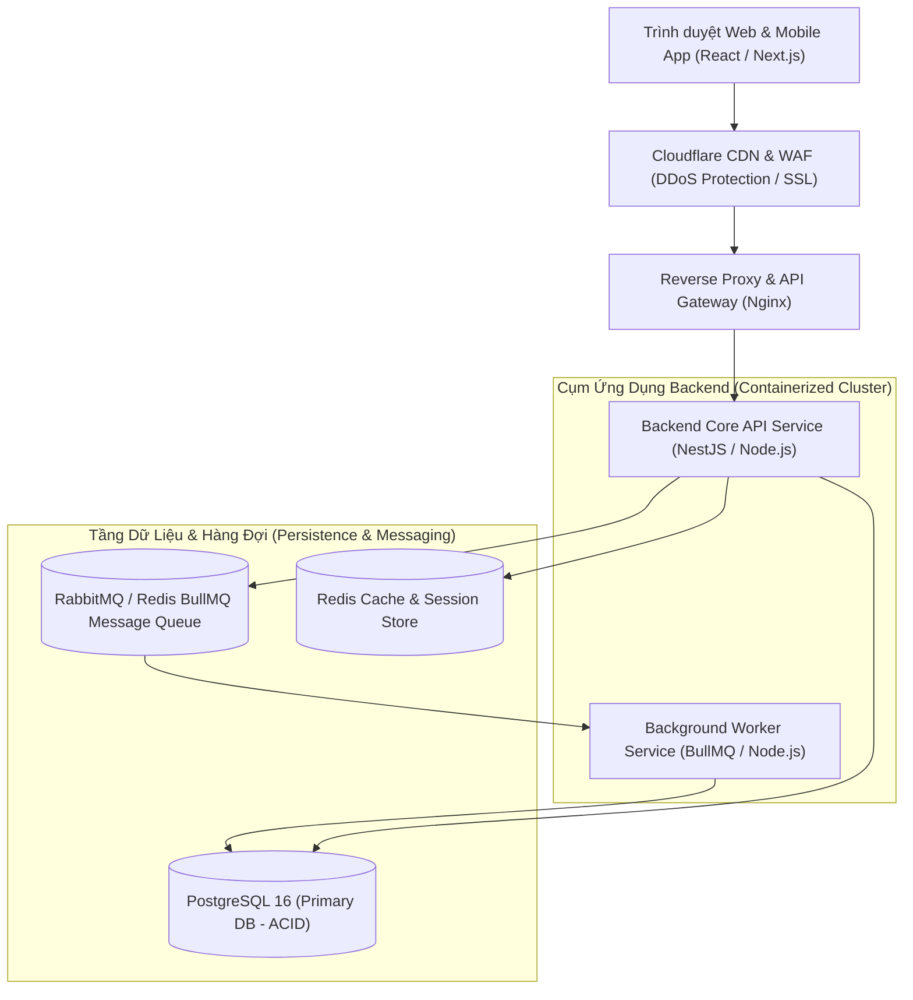

# TÀI LIỆU KIẾN TRÚC HỆ THỐNG (SYSTEM ARCHITECTURE DOCUMENT - SAD)

## 1. Mô Hình Kiến Trúc C4 (C4 Model Architecture)

### C4 Level 1: Ngữ Cảnh Hệ Thống (System Context)

### C4 Level 2: Cấu Trúc Thành Phần (Containers Diagram)

---

## 2. Quyết Định Mô Hình Kiến Trúc: Modular Monolith
* **Lý do lựa chọn:** Dự án giai đoạn đầu cần tốc độ phát triển nhanh (Time-to-market), tránh sự phức tạp quá mức về quản trị mạng, độ trễ RPC và phân tán dữ liệu của Microservices thuần túy.
* **Chiến lược:** Xây dựng theo mô hình **Modular Monolith** (Các module tách biệt ranh giới nghiệp vụ - Bounded Contexts, giao tiếp qua Event Bus trong bộ nhớ). Khi một phân hệ cần scale độc lập (ví dụ phân hệ Báo cáo hoặc Thanh toán), kiến trúc có thể tách thành Microservice riêng trong vòng 1-2 Sprint mà không cần viết lại toàn bộ mã nguồn.

---

## 3. Kiến Trúc Bảo Mật & Xác Thực (Security Architecture)
* **Xác thực:** Chuẩn OAuth 2.0 / OpenID Connect kết hợp JWT (JSON Web Tokens).
* **Quản lý Token:**
  - `Access Token`: Mã hóa ký bằng khóa bí mật RS256, thời gian sống ngắn (15 phút), chứa `user_id`, `roles`, `permissions`.
  - `Refresh Token`: Lưu trữ trong HttpOnly, Secure, SameSite=Strict Cookie trên trình duyệt, hạn 7 ngày, có cơ chế **Refresh Token Rotation** (Hủy toàn bộ phiên nếu phát hiện token bị đánh cắp).
* **Phân quyền (Authorization):** Role-Based Access Control (RBAC) kết hợp Resource-Based Policy.
* **Mã hóa:** Toàn bộ dữ liệu truyền nhận bắt buộc HTTPS (TLS 1.3). Dữ liệu thẻ ngân hàng tuyệt đối không lưu trữ trên máy chủ nội bộ (ủy thác hoàn toàn cho đối tác đạt chuẩn PCI-DSS).

