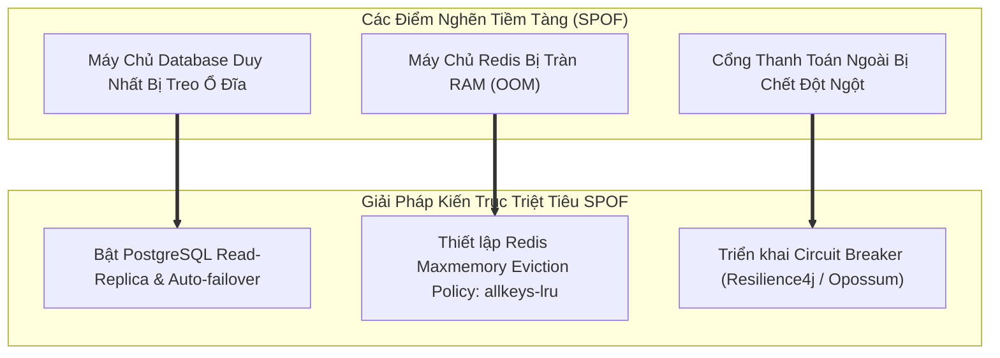

# ĐÁNH GIÁ RỦI RO KỸ THUẬT & ĐIỂM NGHẼN HỆ THỐNG (TECHNICAL RISK ASSESSMENT)

## 1. Phân Tích Điểm Lỗi Đơn Lẻ (Single Point of Failure - SPOF) & Giải Pháp Khắc Phục

---

## 2. Ma Trận Kỹ Thuật Dự Phòng & Khắc Phục Thảm Họa (Disaster Recovery Targets)

| Chỉ Số | Mục Tiêu Cam Kết | Cơ Chế Đạt Được Mục Tiêu |
|---|:---:|---|
| **RPO (Recovery Point Objective)** | **< 15 Phút** | Bật cơ chế PostgreSQL Write-Ahead Logging (WAL) sao lưu liên tục từng block lên Cloudflare R2 / AWS S3 |
| **RTO (Recovery Time Objective)** | **< 30 Phút** | Triển khai tự động hóa hạ tầng bằng Terraform & Ansible; Docker Compose dựng lại toàn bộ stack trong 1 script |
| **Rate Limit Ngăn DDoS** | **100 req/min/IP** | Cấu hình Cloudflare WAF tầng ngoài cùng + Redis Token Bucket Filter tầng API Gateway |
| **Circuit Breaker Threshold** | **50% lỗi trong 10s** | Nếu đối tác ngân hàng lỗi > 50% trong 10 giây, lập tức ngắt mạch tạm thời (Trip circuit), thông báo khách chọn hình thức khác |

