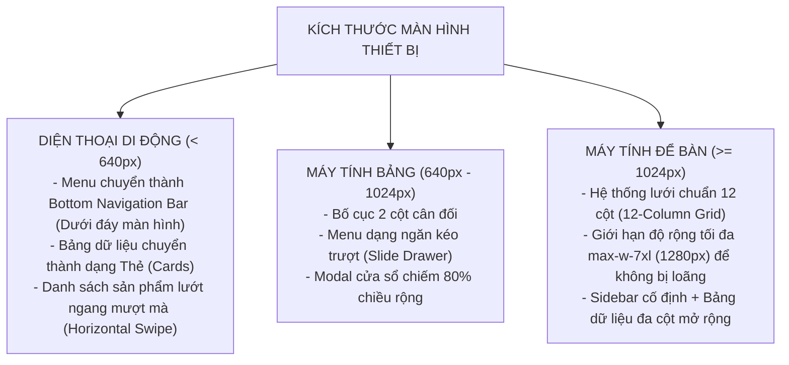

# 03. QUY TẮC THIẾT KẾ THÍCH ỨNG LINH HOẠT ĐA THIẾT BỊ
## (FLUID RESPONSIVE DESIGN & CUSTOMER-CENTRIC UI)

> **Mục tiêu cốt lõi:** Đảm bảo sản phẩm hiển thị hoàn mỹ trên mọi kích thước màn hình từ chiếc điện thoại iPhone màn hình nhỏ (375px) cho tới màn hình máy tính bàn 4K siêu rộng (1920px+), luôn đặt nhu cầu thao tác thuận tiện nhất của khách hàng làm trung tâm.

---

## 1. Triết Lý Thiết Kế Thích Ứng Động (Fluid Responsive Philosophy)

Chúng ta không thiết kế web tĩnh rồi "bóp méo" để nhét vào điện thoại. Đội ngũ áp dụng kỹ thuật **Co dãn mượt mà (Fluid Scale)** bằng hàm `clamp()` hiện đại của CSS:
* **Cỡ chữ tự động co giãn theo chiều rộng màn hình:**
  ```css
  /* Tự động tăng đều từ 28px trên Mobile lên 48px trên Desktop mà không bị nhảy đột ngột */
  font-size: clamp(1.75rem, 1.2rem + 2.5vw, 3rem);
  ```
* **Khoảng cách lề (Padding / Margin) tự thích ứng:**
  ```css
  padding-inline: clamp(1rem, 5vw, 4rem);
  ```

---

## 2. Chiến Lược Bố Cục Chuyển Đổi Theo Từng Nhóm Thiết Bị



---

## 3. Ưu Tiên Nhu Cầu Thao Tác Của Khách Hàng (Customer Ergonomics)

### 📱 1. Quy Tắc Vùng Thao Tác Ngón Tay Cái (The Mobile Thumb Zone):
Hơn 85% người dùng cầm điện thoại bằng một tay và thao tác hoàn toàn bằng ngón tay cái:
* **Vùng Tự Nhiên Dễ Bấm Nhất (Vùng đáy màn hình):** Bắt buộc đặt các nút bấm kiếm ra tiền tại đây: Nút *"Mua ngay"*, *"Thêm vào giỏ"*, và thanh điều hướng chính (*Trang chủ, Tìm kiếm, Giỏ hàng, Tài khoản*).
* **Vùng Khó Vươn Tới Nhất (Góc trên cùng bên trái):** Tuyệt đối không đặt các nút quan trọng ở góc này trên giao diện điện thoại.

### 👆 2. Kích Thước Vùng Chạm Tối Thiểu (Minimum Touch Targets):
* Mọi nút bấm, icon, checkbox trên giao diện cảm ứng phải có diện tích chạm tối thiểu là **48px x 48px** (theo chuẩn Google Human Interface & Apple HIG), ngay cả khi icon thị giác chỉ nhỏ 20px (bù đắp bằng padding trong suốt).
* Khoảng cách giữa 2 nút bấm liền kề phải cách nhau tối thiểu **8px** để ngăn chặn triệt để tình trạng khách hàng bấm nhầm nút Hủy thay vì nút Xác Nhận.

---

## 4. Bảng Kiểm Tra Kỷ Luật Responsive Trước Khi Xuất Xưởng (QC Checklist)

- [ ] **Không xuất hiện thanh cuộn ngang tai hại (No Horizontal Scroll):** Kiểm tra kỹ lưỡng toàn bộ các trang, không để bất kỳ ảnh hay khối văn bản nào làm phình trang gây hiện tượng cuộn ngang trên điện thoại (`overflow-x: hidden`).
- [ ] **Bàn phím ảo không che khuất nút bấm:** Trên màn hình thanh toán của điện thoại, khi bàn phím ảo bật lên để nhập mã OTP hoặc số thẻ, nút "Xác nhận" phải tự động trồi lên trên bàn phím.
- [ ] **Hình ảnh sắc nét và tự động nén kích thước:** Khách dùng màn hình nhỏ tải ảnh 400px nhẹ, khách dùng màn hình máy tính tải ảnh 1200px sắc nét (thông qua component `next/image` với thuộc tính `srcset`).

