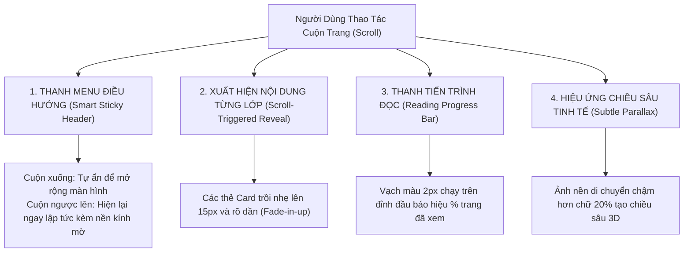

# 02. ĐẶC TẢ TRẢI NGHIỆM CUỘN MƯỢT MÀ & CHUYỂN ĐỘNG THỊ GIÁC
## (KINETIC SMOOTH SCROLLING & MOTION UX SPECIFICATIONS)

> **Mục tiêu cốt lõi:** Biến hành động cuộn trang (Scroll) từ một thao tác giật cục thông thường trở thành một **trải nghiệm lướt êm ái, liền mạch như lướt trên mặt nước**, giữ chân người dùng khám phá sâu vào nội dung mà không gây gián đoạn hay mỏi mắt.

---

## 1. Kiến Trúc Cuộn Mượt Mà 60FPS / 120FPS (Kinetic Smooth Scroll Engine)

Để đạt được cảm giác cuộn mượt mà sang trọng chuẩn các trang web công nghệ đỉnh cao thế giới (như Apple, Stripe, Linear):
* **Giải pháp công nghệ:** Tích hợp thư viện cuộn động lực học siêu nhẹ **Lenis Scroll** (dưới 3KB) hoặc thuộc tính CSS phần cứng tăng tốc GPU:
  ```css
  html.lenis, html.lenis body {
    height: auto;
  }
  .lenis.lenis-smooth {
    scroll-behavior: auto !important;
  }
  .lenis.lenis-smooth [data-lenis-prevent] {
    overscroll-behavior: contain;
  }
  ```
* **Thông số cân chỉnh động lực học (Physics Easing):**
  - Thời gian giảm tốc (Duration): **1.2 giây**.
  - Hệ số quán tính (Damping / Friction): `0.1` – tạo cảm giác trôi nhẹ tự nhiên khi thả con lăn chuột nhưng lập tức dừng chính xác khi người dùng chạm vào màn hình cảm ứng điện thoại.

---

## 2. Các Hành Vi Tương Tác Khi Cuộn (Scroll Behaviors)



### Chi Tiết Từng Trải Nghiệm Cụ Thể:

### 🌟 Trải Nghiệm 1: Thanh Menu Thông Minh (Smart Auto-Hide & Glass Header)
* **Khi ở đỉnh trang (`scrollY = 0`):** Menu trong suốt hoàn toàn, hòa quyện với ảnh Banner Hero.
* **Khi cuộn xuống (`scrollY > 50px`):** Kích hoạt hiệu ứng kính mờ sương (`backdrop-blur-md bg-slate-900/80` hoặc `bg-white/80`) và đường viền 1px siêu mảnh chống chói.
* **Cơ chế Headroom (Tự ẩn - Hiện thông minh):**
  - Khi người dùng **cuộn xuống**: Menu tự động trượt ẩn lên trên 100% để trả lại toàn bộ không gian đọc cho người dùng.
  - Khi người dùng **hơi nhích cuộn ngược lên một chút (dù chỉ 10px)**: Menu lập tức trượt xuống êm ái trong 250ms, giúp người dùng bấm giỏ hàng hoặc tìm kiếm ngay mà không cần mất công cuộn ngược mỏi tay lên đầu trang.

### 🌟 Trải Nghiệm 2: Hiệu Ứng Trồi Nội Dung Nhịp Nhàng (Staggered Scroll Reveal)
* Các thẻ Card sản phẩm, icon tính năng không xuất hiện thô kệch cùng lúc mà trồi nhẹ lần lượt (Stagger delay 80ms giữa các thẻ):
  - Dùng API trình duyệt native `IntersectionObserver` để chỉ kích hoạt hiệu ứng khi phần tử lọt vào 15% tầm nhìn của mắt người dùng (`threshold: 0.15`).
  - Khoảng cách di chuyển trồi lên cực ngắn: Chỉ **15px đến 20px**, độ mờ chuyển từ `opacity: 0` sang `opacity: 1` trong **400ms**. Tuyệt đối không để trồi từ quá xa (50-100px) vì sẽ gây cảm giác chậm chạp và giật màn hình.

### 🌟 Trải Nghiệm 3: Tối Ưu Bánh Xe Chuột & Cảm Ứng Di Động (Touch Inertia)
* Trên thiết bị di động (iPhone / Android): Tuyệt đối không can thiệp đè lên cơ chế cuộn cảm ứng tự nhiên của hệ điều hành (Native Momentum Scrolling `-webkit-overflow-scrolling: touch`) để giữ trọn vẹn cảm giác quen thuộc của ngón tay người dùng.

---

## 3. Kỷ Luật Kỹ Thuật: Chống Giật Khung Hình & Bảo Vệ Tốc Độ (Anti-Jank Rules)

Trải nghiệm cuộn mượt mà chỉ có giá trị khi nó **không làm nóng máy, không hao pin và không gây giật (Jank)**:
1. **Chỉ dùng thuộc tính tăng tốc GPU:** 100% hiệu ứng cuộn chỉ được phép tác động vào 2 thuộc tính: `transform` (Translate, Scale) và `opacity`. Tuyệt đối CẤM thay đổi `top`, `left`, `margin`, `padding` trong lúc cuộn vì sẽ gây hiện tượng tính toán lại toàn bộ trang (Layout Thrashing).
2. **Khai báo gợi ý cho card đồ họa:** Bật thuộc tính `will-change: transform` cho các thành phần đang trôi nổi để trình duyệt nạp sẵn vào bộ nhớ GPU.
3. **Bảo vệ chỉ số Google INP (Interaction to Next Paint):** Toàn bộ sự kiện lắng nghe cuộn (`window.addEventListener('scroll')`) phải được bọc trong hàm tối ưu `requestAnimationFrame` hoặc cơ chế thụ động `{ passive: true }`.

