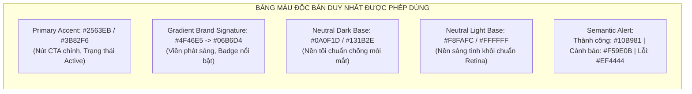

# 01. BẢN SẮC THIẾT KẾ ĐỘC BẢN & KỶ LUẬT THỊ GIÁC NGHIÊM NGẶT
## (STRICT BRAND IDENTITY, CREATIVE UI RULES & DESIGN DISCIPLINE)

> **Tuyên ngôn phòng thiết kế:** *"Sáng tạo không đồng nghĩa với tùy tiện. Một giao diện đẳng cấp, bắt mắt đến từ sự sáng tạo có bản sắc riêng, kết hợp với kỷ luật thép về Màu sắc và Typography xuyên suốt từ đầu tới cuối dự án. Tuyệt đối không có chuyện 'thích màu nào chấm màu đó' hay 'thích cỡ chữ nào gõ cỡ chữ đó'."*

---

## 1. Bản Sắc Thiết Kế Sáng Tạo Riêng Biệt Của Đội Ngũ (Creative UI Signature)

Dự án không đi theo lối mòn của các template mua sẵn nhạt nhòa. Đội ngũ thiết lập ngôn ngữ thiết kế riêng biệt: **Neo-Modern Glass & Precision Dark/Light System**:
* **Triết lý chiều sâu (Depth & Elevation):** Sử dụng các lớp nền trong mờ tinh tế (Backdrop Blur / Frosted Glass) kết hợp viền sáng siêu mảnh 1px (`border-white/10` hoặc `border-slate-200`) tạo cảm giác sản phẩm cao cấp, tinh xảo.
* **Tỷ lệ vàng thị giác 60 - 30 - 10 trong phối màu:**
  - **60% Không gian nền (Dominant):** Màu nền sạch sẽ, tĩnh lặng (`#0A0F1D` chế độ Tối / `#F8FAFC` chế độ Sáng) giúp mắt người dùng nghỉ ngơi và tập trung 100% vào sản phẩm.
  - **30% Cấu trúc & Nội dung (Secondary):** Các thẻ Card, Khung thông tin, Thanh Sidebar (`#131B2E` / `#FFFFFF`).
  - **10% Điểm nhấn kích thích hành động (Accent / Electric Glow):** Màu nhận diện độc bản (`#2563EB` kết hợp Gradient Electric Indigo `#4F46E5` -> `#06B6D4`) – CHỈ dành riêng cho nút CTA quan trọng nhất (Mua ngay, Đặt cọc) và chỉ báo trạng thái cao điểm.

---

## 2. Kỷ Luật Thép Về Bảng Màu (Strict Color Discipline)

Lập trình viên và Designer **CHỈ ĐƯỢC PHÉP** sử dụng các mã màu cố định trong bảng bên dưới. **CẤM TUYỆT ĐỐI** việc tự ý thêm mã Hex lạ vào mã nguồn!



### Bảng Quy Định Mã Màu Cố Định (Strict Tokens):

| Tên Token Chuẩn | Mã Hex | Ý Nghĩa Sử Dụng Bắt Buộc | Quy Định Kỷ Luật |
|---|---|---|---|
| `color-brand-primary` | `#2563EB` | Nút bấm chính, Icon đang chọn | Không dùng làm màu chữ đoạn văn |
| `color-brand-hover` | `#1D4ED8` | Trạng thái Hover của nút chính | Chuyển màu mượt trong 150ms |
| `color-brand-gradient`| `linear-gradient(135deg, #4F46E5 0%, #06B6D4 100%)` | Điểm nhấn Hero banner, viền Avatar VIP | Tối đa 2 vị trí trên một màn hình |
| `color-text-title` | `#0F172A` (Light) / `#F8FAFC` (Dark) | Tiêu đề chính Heading (H1, H2) | Độ tương phản đạt chuẩn AAA (7:1) |
| `color-text-body` | `#334155` (Light) / `#94A3B8` (Dark) | Đoạn văn mô tả, nội dung bài viết | Tuyệt đối không dùng màu xám quá nhạt |
| `color-text-muted` | `#64748B` (Light) / `#64748B` (Dark) | Ngày tháng, nhãn phụ, placeholder | Chỉ dùng cho thông tin bổ trợ |
| `color-status-success`| `#10B981` | Đơn đã thanh toán, Còn hàng | Luôn đi kèm icon tích xanh |
| `color-status-danger` | `#EF4444` | Hết hàng, Lỗi nhập liệu, Hủy đơn | Bắt buộc có thông báo nguyên nhân |

---

## 3. Kỷ Luật Typography: Font Chữ & Thang Đo Cố Định (Strict Type Scale)

Dự án chỉ sử dụng duy nhất **1 họ Font chữ đồng nhất** để đảm bảo tính đồng bộ hoàn hảo:
* **Họ Font chuẩn hóa:** `Plus Jakarta Sans` (hoặc `Inter` dự phòng) – họ font hình học (Geometric Sans) hiện đại bậc nhất thế giới, được cân chỉnh tối ưu cho khả năng hiển thị siêu nét trên mọi thiết bị di động và Retina.

### Thang Cỡ Chữ Cố Định (Modular Scale - Cấm Dùng Cỡ Chữ Tùy Tiện):

```
Display 1 (48px)   ---> Dành riêng cho Tiêu đề Banner Trang chủ (Hero Headline)
Heading 1 (32px)   ---> Tiêu đề trang chính (Page Title)
Heading 2 (24px)   ---> Tiêu đề từng khối (Section Title)
Heading 3 (20px)   ---> Tiêu đề Card sản phẩm, Modal Header
Body Large (16px)  ---> Cỡ chữ đọc mặc định chuẩn (Default Body)
Body Small (14px)  ---> Bảng dữ liệu, mô tả phụ kiện, ghi chú form
Caption (12px)     ---> Nhãn Badge nhỏ, Timestamp, bản quyền Footer
```

* **Quy tắc chiều cao dòng (Line-Height):**
  - Đối với tiêu đề lớn (Heading): `line-height: 1.2` đến `1.25` (Tránh các dòng quá xa nhau làm loãng bố cục).
  - Đối với đoạn văn bản (Body): `line-height: 1.5` đến `1.6` (Khoảng cách hoàn hảo để mắt đọc lướt không bị mỏi).
* **Quy tắc cấm kỵ:**
  - ❌ **CẤM:** Không dùng các cỡ chữ lẻ như 13px, 15px, 17px, 19px, 23px.
  - ❌ **CẤM:** Không dùng quá 3 độ đậm font (Font weights) trên một màn hình. Chỉ dùng: `Regular (400)`, `Medium (500)`, `SemiBold (600)` và `Bold (700)`.

---

## 4. Danh Sách Các Lỗi Thiết Kế Bị Nghiêm Cấm (Design Anti-Patterns)

1. **Không tạo "cây thông noel" về màu sắc:** Một màn hình không được có quá 3 màu nhấn rực rỡ cùng lúc. Mọi yếu tố cạnh tranh thị giác phải bị loại bỏ để mắt người dùng hướng thẳng về nút hành động chính (Primary CTA).
2. **Không dùng bóng đổ màu đen đặc (No Dirty Shadows):** Tuyệt đối không dùng `box-shadow: 0 10px 20px rgba(0, 0, 0, 0.5)`. Bóng đổ phải được tán mịn đa tầng và pha màu của chính bề mặt nền (`box-shadow: 0 10px 30px -5px rgba(15, 23, 42, 0.08)`).
3. **Không để nút bấm bị "chìm":** Nút hành động mang lại tiền (Đặt hàng, Thanh toán) phải luôn có độ tương phản mạnh nhất trên trang, kích thước tối thiểu `48px` chiều cao để ngón tay cái dễ bấm.

