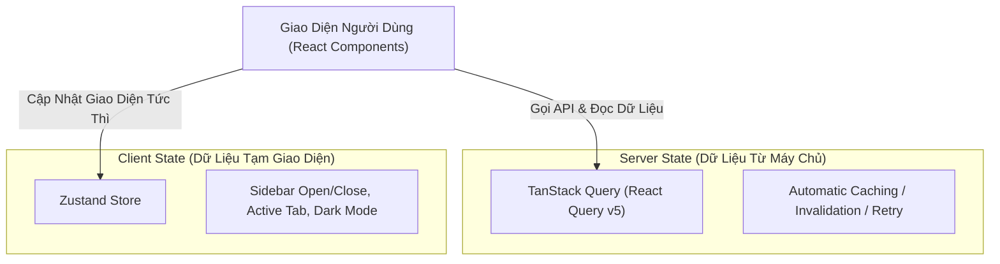

# QUY CHUẨN QUẢN LÝ TRẠNG THÁI (STATE MANAGEMENT ARCHITECTURE)

## 1. Phân Tách Trạng Thái Rõ Ràng (State Separation)

---

## 2. Chiến Lược Cập Nhật Lạc Quan (Optimistic Updates)
* Đối với các hành động tương tác thường xuyên như: *Bấm Thích sản phẩm, Thêm vào giỏ hàng, Đổi trạng thái checkbox*:
  - **Bước 1:** Giao diện lập tức đổi màu hoặc tăng số lượng ngay tại giây thứ 0 (0ms) để người dùng cảm thấy phản hồi tức thì.
  - **Bước 2:** Gửi request ngầm lên Backend API.
  - **Bước 3:** Nếu mạng lỗi hoặc máy chủ trả về thất bại ➔ TanStack Query tự động **Rollback** trạng thái giao diện về như cũ và bật một thông báo thông cảm (Toast error) cho người dùng.

