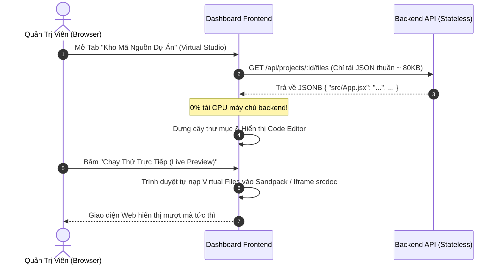

# KIẾN TRÚC CLIENT-SIDE IN-BROWSER CODE PREVIEW (0% SERVER CPU)
## DÀNH CHO FRONTEND DEVELOPER & UI/UX DESIGNER

> [!TIP]
> Việc biên dịch, bundling và chạy thử (Live Preview) giao diện website của từng người dùng tuyệt đối KHÔNG thực hiện trên server bằng lệnh `npm run dev`. Toàn bộ tác vụ render giao diện được đẩy 100% xuống CPU và RAM của chính trình duyệt người dùng.

---

## 1. MÔ HÌNH THI CÔNG TRÌNH DIỄN GIAO DIỆN (SANDPACK / SRCDOC)

---

## 2. QUY CHUẨN XUẤT ZIP TRỰC TIẾP TRÊN TRÌNH DUYỆT

- Sử dụng thư viện `JSZip` chạy trực tiếp trên luồng Worker hoặc RAM của trình duyệt.
- Người dùng bấm nút **"Tải Trọn Bộ ZIP Code"**:
  - Mã nguồn từ chuỗi JSON được nén thành blob `.zip` ngay trong bộ nhớ client.
  - Tự động kích hoạt hành động tải xuống (`saveAs(blob, "project.zip")`).
  - Máy chủ không tốn 1 byte ổ cứng để tạo file tạm.

