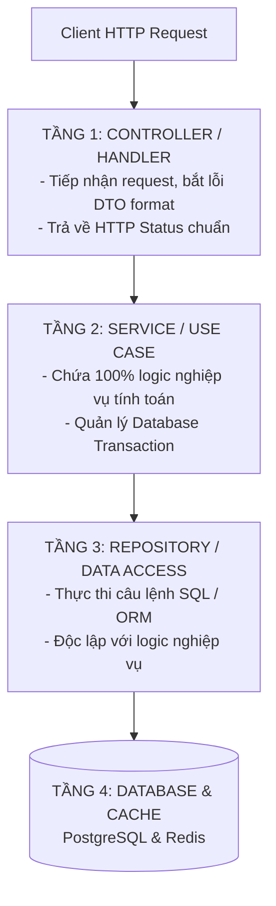

# TIÊU CHUẨN KIẾN TRÚC PHÂN TẦNG BACKEND (CLEAN ARCHITECTURE)

## 1. Sơ Đồ Luồng Xử Lý 4 Tầng



---

## 2. Các Nguyên Tắc Vàng Trong Lập Trình Backend
1. **Controller "mỏng", Service "dày" (Thin Controller, Fat Service):** Controller tuyệt đối không chứa câu lệnh `if/else` tính tiền hoặc gọi SQL trực tiếp.
2. **Quản lý Transaction chặt chẽ cho thao tác Tiền Tệ & Tồn Kho:** Mọi hoạt động trừ tiền và xuất kho bắt buộc phải được bao bọc trong một `Database Transaction (ACID)`. Nếu bất kỳ bước nào lỗi, hệ thống phải `ROLLBACK` ngay lập tức, không để lại dữ liệu rác.
3. **Chuẩn hóa phản hồi lỗi (Centralized Error Normalization):** Toàn bộ exception phải được bắt qua Global Exception Filter và trả về định dạng JSON thống nhất:
```json
{
  "statusCode": 400,
  "timestamp": "2026-11-20T10:00:00.000Z",
  "path": "/api/v1/orders",
  "error": "OUT_OF_STOCK",
  "message": "Sản phẩm SKU-123 chỉ còn 0 chiếc trong kho.",
  "details": []
}
```

