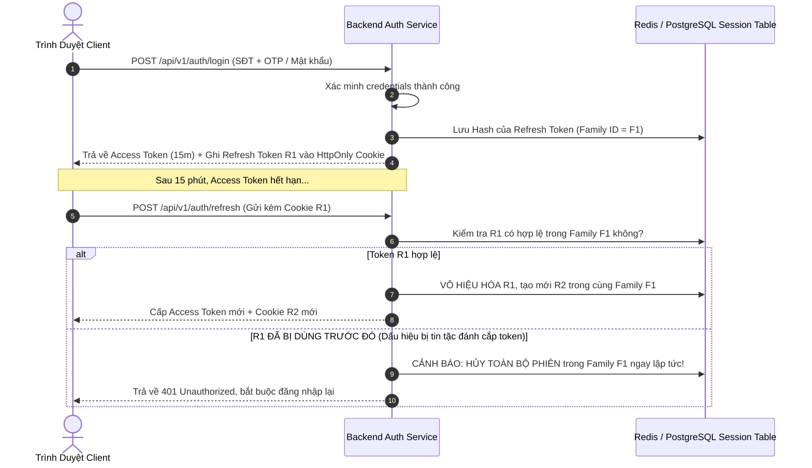

# BẢO MẬT XÁC THỰC JWT KÉP & PHÂN QUYỀN VAI TRÒ (RBAC)

## 1. Cơ Chế Xoay Vòng Refresh Token (Refresh Token Rotation)

---

## 2. Triển Khai Role-Based Access Control (RBAC Guard)
Sử dụng Custom Decorator `@Roles('ADMIN', 'STORE_MANAGER')` trên các Controller. Guard sẽ trích xuất danh sách roles từ Access Token đã giải mã, kiểm tra đối chiếu trước khi cho phép request đi vào hàm Service.

