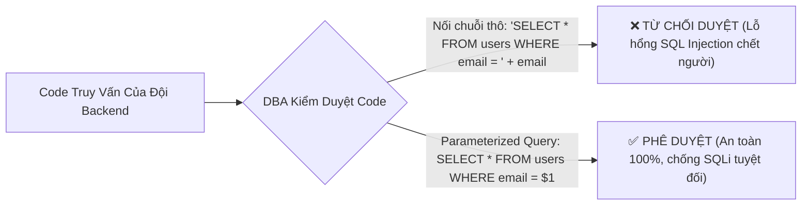

# 04. BẢO MẬT CƠ SỞ DỮ LIỆU & HÀNG RÀO CHỐNG SQL INJECTION TẦNG DBA
## (DATABASE DATA SECURITY, PRIVILEGE ISOLATION & INJECTION DEFENSE)

> **Sứ mệnh tối thượng của DBA:** *"Cơ sở dữ liệu là pháo đài cuối cùng cất giữ tài sản thông tin của người dùng. DBA là người gác cổng tối cao đảm bảo: Dù hacker có chui lọt qua tầng mạng hay tầng Backend, thì cũng KHÔNG THỂ đánh cắp hay xóa sổ cơ sở dữ liệu."*

---

## 1. Nguyên Tắc Phân Quyền Tối Thiểu (Principle of Least Privilege)

Một trong những sai lầm chết người của các dự án thiếu kinh nghiệm là: **Cho mã nguồn Backend kết nối vào database bằng tài khoản `postgres` hoặc tài khoản có quyền `SUPERUSER`**.

### Giải Pháp Phân Tách Quyền Lực Độc Lập Từ DBA:
DBA tạo riêng một tài khoản chuyên dụng `app_backend_user` với các hạn chế nghiêm ngặt:

```sql
-- 1. Tạo người dùng riêng cho ứng dụng Backend với mật khẩu mạnh
CREATE USER app_backend_user WITH PASSWORD 'StrongAppPassword2026!Secure';

-- 2. Chỉ cấp quyền đọc và ghi dữ liệu nghiệp vụ thông thường
GRANT CONNECT ON DATABASE enterprise_production_db TO app_backend_user;
GRANT USAGE ON SCHEMA public TO app_backend_user;
GRANT SELECT, INSERT, UPDATE, DELETE ON ALL TABLES IN SCHEMA public TO app_backend_user;
GRANT USAGE, SELECT ON ALL SEQUENCES IN SCHEMA public TO app_backend_user;

-- 3. TƯỚC ĐOẠT TOÀN BỘ QUYỀN NGUY HIỂM:
-- Backend KHÔNG THỂ chạy lệnh DROP TABLE, TRUNCATE, hoặc ALTER TABLE!
REVOKE CREATE ON SCHEMA public FROM app_backend_user;
ALTER DEFAULT PRIVILEGES IN SCHEMA public REVOKE ALL ON TABLES FROM app_backend_user;
GRANT SELECT, INSERT, UPDATE, DELETE ON TABLES TO app_backend_user;
```

> 🛡️ **Ý nghĩa bảo mật:** Ngay cả trong trường hợp xấu nhất khi một lập trình viên Backend vô tình để lộ lỗ hổng SQL Injection, tin tặc cũng **KHÔNG THỂ gõ lệnh `DROP TABLE users;` hay `TRUNCATE orders;`** vì Database sẽ lập tức từ chối quyền thực thi!

---

## 2. Hàng Rào Chặn Đứng SQL Injection: Kiểm Soát Truy Vấn Từ Backend

DBA ban hành quy chuẩn bắt buộc và thực hiện kiểm duyệt mã nguồn (Audit Code Review) đối với toàn bộ các câu truy vấn do đội Backend viết:



### Tiêu Chuẩn Truy Vấn Tham Số Hóa (Parameterized Queries):
* Mọi biến số truyền vào từ người dùng phải được truyền qua dạng tham số vị trí `$1, $2, $3` (hoặc `?`).
* Trình điều khiển cơ sở dữ liệu (PostgreSQL Driver) sẽ gửi riêng cấu trúc câu lệnh và dữ liệu tham số. Cơ sở dữ liệu sẽ coi tham số truyền vào thuần túy là chuỗi ký tự (Literal String), **không bao giờ biên dịch nó thành mã lệnh thực thi**, vô hiệu hóa 100% mọi nỗ lực chèn `' OR '1'='1`.

---

## 3. Bảo Vệ Dữ Liệu Nhạy Cảm & Mã Hóa Tại Cột (Data Privacy & Encryption)

Để bảo vệ thông tin người dùng tuân thủ Nghị định 13/2023/NĐ-CP và tiêu chuẩn an toàn thông tin quốc tế:
1. **Mã hóa đường truyền (In-Transit):** Bắt buộc cấu hình `sslmode=require` trong connection string. Toàn bộ dữ liệu truyền giữa Backend và PostgreSQL được mã hóa TLS 1.3, chống nghe lén gói tin trên mạng nội bộ.
2. **Mã hóa dữ liệu tại chỗ (At-Rest):** Toàn bộ ổ đĩa chứa dữ liệu Database được mã hóa phần cứng bằng tiêu chuẩn **AES-256**.
3. **Mã hóa cột nhạy cảm bằng Extension `pgcrypto`:**
   ```sql
   -- Mã hóa số căn cước / tài khoản ngân hàng nhạy cảm của người dùng trước khi lưu
   INSERT INTO user_bank_accounts (user_id, encrypted_account_number)
   VALUES ($1, pgp_sym_encrypt('1903847291823', 'SecretServerKey2026'));
   ```

---

## 4. Bảo Vệ Dữ Liệu Cấp Độ Dòng (Row-Level Security - RLS)

Đối với các bảng dữ liệu nhạy cảm của khách hàng, DBA bật tính năng **Row-Level Security (RLS)**:
```sql
-- Bật tính năng RLS trên bảng đơn hàng
ALTER TABLE orders ENABLE ROW LEVEL SECURITY;

-- Khách hàng chỉ có quyền nhìn thấy đơn hàng của chính mình, không thể xem đơn của người khác
CREATE POLICY customer_orders_isolation ON orders
    FOR SELECT
    USING (user_id = current_setting('app.current_user_id')::uuid);
```
Ngay cả khi câu lệnh SELECT bị lỗi logic ở Backend, Database vẫn tự động lọc đúng dữ liệu của người dùng hiện tại, ngăn ngừa triệt để lỗi rò rỉ dữ liệu giữa các tài khoản khách hàng.

