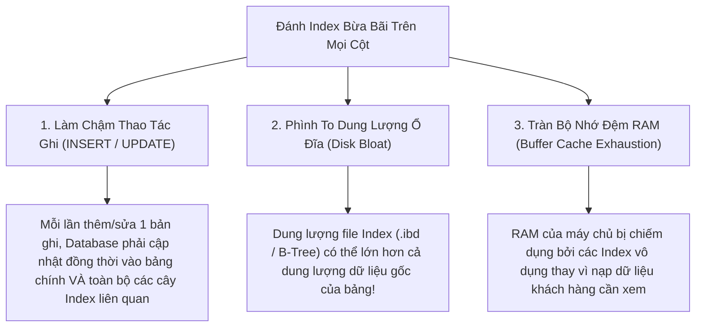

# 02. KỶ LUẬT ĐÁNH CHỈ MỤC THÉP & KIỂM SOÁT PHÌNH Ổ ĐĨA
## (STRICT INDEXING DISCIPLINE & BLOAT PREVENTION)

> **Cảnh báo từ Chuyên gia Dữ liệu:** *"Index là con dao hai lưỡi. Một index hữu ích giúp câu SELECT chạy nhanh gấp 100 lần, nhưng đánh index bừa bãi sẽ **BÓP NGHẸT tốc độ INSERT / UPDATE**, làm phình to dung lượng ổ đĩa gấp 2 - 3 lần và nhanh chóng làm cạn kiệt bộ nhớ RAM của hệ thống!"*

---

## 1. Tác Hại Khôn Lường Khi Đánh Index Bừa Bãi



---

## 2. 4 Điều Cấm Kỵ Khi Đánh Index (Strict Anti-Patterns)

1. ❌ **CẤM đánh index trên cột có độ đa dạng thấp (Low Cardinality):**
   - Không đánh B-Tree index đơn lẻ trên các cột nhị phân chỉ có 2 giá trị như: `is_active (TRUE/FALSE)` hoặc `gender (MALE/FEMALE)`. Bộ tối ưu hóa truy vấn của PostgreSQL sẽ tự động bỏ qua index này và quét toàn bảng vì chi phí nạp index còn đắt hơn đọc thẳng.
2. ❌ **CẤM tạo Index trùng lặp (Redundant Indexes):**
   - Nếu bạn đã có Composite Index `idx_orders_user_status (user_id, order_status)` ➔ **CẤM** tạo thêm index đơn lẻ `idx_orders_user (user_id)`. Cây B-Tree của index kết hợp đã tự động hỗ trợ truy vấn tìm kiếm theo `user_id` nhờ quy tắc tiền tố bên trái!
3. ❌ **CẤM đánh index trên bảng ít dữ liệu (< 1.000 dòng):**
   - Với các bảng danh mục nhỏ, toàn bộ bảng nằm gọn trong đúng 1 trang nhớ (Memory Block 8KB). Quét trực tiếp chỉ mất 0.05ms, đánh index chỉ làm tốn thêm RAM.
4. ❌ **CẤM đánh index trên cột thường xuyên bị UPDATE liên tục:**
   - Cột như `view_count` hoặc `last_active_at` bị cập nhật liên tục mỗi giây sẽ buộc cơ sở dữ liệu phải cấu trúc lại cây nhị phân liên tục, làm CPU máy chủ nhảy vọt lên 100%.

---

## 3. Câu Lệnh SQL Truy Tìm & Tiêu Diệt Các Index Rác Không Bao Giờ Dùng

DBA chạy script này định kỳ hàng tuần để phát hiện các index "ngốn ổ đĩa" nhưng số lần quét bằng 0:

```sql
SELECT
    schemaname || '.' || relname AS ten_bang,
    indexrelname AS ten_index,
    pg_size_pretty(pg_relation_size(i.indexrelid)) AS dung_luong_index,
    idx_scan AS so_lan_duoc_su_dung
FROM pg_stat_user_indexes ui
JOIN pg_index i ON ui.indexrelid = i.indexrelid
WHERE NOT indisunique -- Bỏ qua các index ràng buộc UNIQUE / PRIMARY KEY bắt buộc
  AND idx_scan = 0    -- Chưa bao giờ được dùng để truy vấn
  AND pg_relation_size(i.indexrelid) > 1024 * 1024 -- Dung lượng lớn hơn 1MB
ORDER BY pg_relation_size(i.indexrelid) DESC;
```

### Cách Xóa Index An Toàn Trên Hệ Thống Đang Chạy Thực Tế:
* **CẤM:** `DROP INDEX ten_index;` ➔ Khóa bảng và làm treo API.
* **CHUẨN:** `DROP INDEX CONCURRENTLY IF EXISTS ten_index;` ➔ Xóa ngầm êm ái, giải phóng ngay lập tức hàng chục GB ổ đĩa mà không ảnh hưởng tới người dùng đang mua sắm.

---

## 4. Giải Pháp Tiết Kiệm Dung Lượng: Partial Index & Covering Index

Thay vì đánh index mù quáng trên toàn bộ 10 triệu dòng, DBA sử dụng:

### 🌟 Partial Index (Chỉ mục một phần có điều kiện):
Chỉ đánh index trên các đơn hàng đang hoạt động, bỏ qua dữ liệu lịch sử đã lưu trữ:
```sql
-- Chỉ đánh index cho các đơn hàng chưa thanh toán cần xử lý gấp
-- Tiết kiệm 90% dung lượng ổ cứng so với index toàn bảng!
CREATE INDEX idx_pending_orders ON orders (created_at) 
WHERE payment_status = 'UNPAID';
```

### 🌟 Covering Index (Chỉ mục bao phủ với mệnh đề INCLUDE):
```sql
-- Cho phép đọc thẳng dữ liệu total_amount từ Index mà không cần chạm vào ổ đĩa bảng chính (Index-Only Scan)
CREATE INDEX idx_orders_covering ON orders (user_id) INCLUDE (total_amount, order_status);
```

