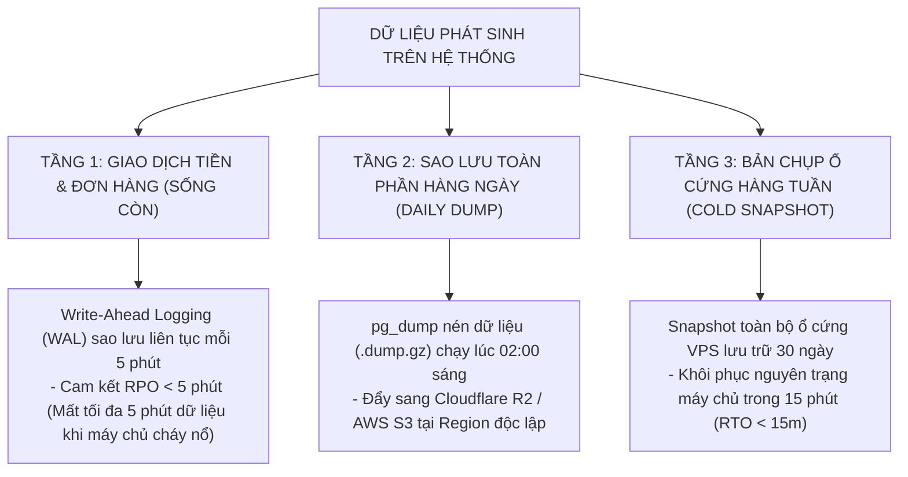

# 03. CHÍNH SÁCH DỌN DẸP RÁC TỰ ĐỘNG & SAO LƯU DỮ LIỆU ĐỊNH KỲ
## (AUTOMATED HOUSEKEEPING, DEAD TUPLES CLEANUP & BACKUP RETENTION)

> **Mục tiêu cốt lõi:** *"Một cơ sở dữ liệu khỏe mạnh là một cơ sở dữ liệu được 'thay máu' và dọn rác định kỳ. Nếu không dọn dẹp hàng rác chết (Dead Tuples) và dữ liệu tạm hết hạn, ổ đĩa sẽ nhanh chóng bị nghẹt, làm tốc độ đọc ghi suy giảm nghiêm trọng."*

---

## 1. Cơ Chế Dọn Rác Tự Động Trong PostgreSQL (Autovacuum Tuning)

Mỗi khi câu lệnh `UPDATE` hoặc `DELETE` diễn ra trong PostgreSQL, dòng dữ liệu cũ không biến mất ngay mà biến thành **"Dòng chết" (Dead Tuples / Bloat)**:
* Nếu không dọn dẹp: Bảng `orders` 100.000 dòng có thể phình to thành 1.000.000 dòng chết ngầm dưới đĩa, làm mọi câu SELECT bị chậm gấp 10 lần.
* **Cấu hình Autovacuum tối ưu từ DBA (`postgresql.conf`):**
```ini
# Bật dọn rác tự động chạy ngầm
autovacuum = on
autovacuum_max_workers = 3

# Kích hoạt dọn dẹp ngay khi có 5% số dòng trong bảng bị thay đổi (thay vì mặc định 20% quá chậm)
autovacuum_vacuum_scale_factor = 0.05
autovacuum_analyze_scale_factor = 0.02

# Tăng ngưỡng chi phí dọn rác để tăng tốc dọn dẹp trong giờ thấp điểm
autovacuum_vacuum_cost_limit = 1000
```

---

## 2. Kịch Bản Dọn Dẹp Dữ Liệu Rác Nghiệp Vụ Chạy Định Kỳ (Cron Housekeeping)

DBA thiết lập tác vụ chạy tự động vào **03:00 sáng mỗi ngày** để dọn dẹp các dữ liệu tạm vô ích:

```sql
-- 1. XÓA BỎ CÁC PHIÊN ĐĂNG NHẬP & TOKEN ĐÃ HẾT HẠN TRÊN 7 NGÀY
DELETE FROM user_sessions 
WHERE expires_at < NOW() - INTERVAL '7 days';

-- 2. XÓA CÁC MÃ OTP SMS ĐÃ HẾT HẠN QUÁ 24 GIỜ
DELETE FROM otp_requests 
WHERE created_at < NOW() - INTERVAL '24 hours';

-- 3. GIẢI PHÓNG GIỎ HÀNG ẢO BỎ QUÊN TRÊN 30 NGÀY
DELETE FROM cart_items 
WHERE updated_at < NOW() - INTERVAL '30 days';

-- 4. LƯU TRỮ VÀ DỌN DẸP NHẬT KÝ HỆ THỐNG (AUDIT LOGS) QUÁ 90 NGÀY
-- Chuyển các log cũ sang bảng lưu trữ lạnh (Cold Storage) trước khi xóa bảng chính
INSERT INTO audit_logs_archive SELECT * FROM audit_logs WHERE created_at < NOW() - INTERVAL '90 days';
DELETE FROM audit_logs WHERE created_at < NOW() - INTERVAL '90 days';
```

---

## 3. Chiến Lược Sao Lưu Đa Tầng Tùy Biến Theo Quy Mô Hệ Thống (Multi-Tier Backup)

Chiến lược sao lưu được thiết kế may đo chuẩn xác dựa trên giá trị và tần suất thay đổi của dữ liệu:



### Bảng Phân Tầng Sao Lưu Dữ Liệu:

| Cấp Độ Dữ Liệu | Phương Thức Sao Lưu | Tần Suất | Nơi Lưu Trữ | Thời Gian Lưu Trữ (Retention) |
|---|---|---|---|---|
| **Cực Kỳ Quan Trọng (Đơn, Tiền, Khách)** | WAL Archiving liên tục (PITR) | **Mỗi 5 phút** | Bucket S3 tách biệt mã hóa AES-256 | Lưu 7 ngày gần nhất |
| **Toàn Bộ Cơ Sở Dữ Liệu** | Full Logical Dump (`pg_dump`) | **Hàng ngày (02:00)** | Cloud Object Storage khác vùng địa lý | Lưu 30 ngày |
| **Hạ Tầng & Cấu Hình Máy Chủ** | Block Storage Snapshot | **Hàng tuần (Chủ nhật)**| VPS Provider Snapshot Vault | Lưu 4 tuần |

---

## 4. Kỷ Luật Thử Nghiệm Khôi Phục (Backup Is Useless Without Restore)

* **Nguyên tắc vàng của DBA:** *"Một bản backup chưa từng được thử khôi phục thành công thì bản backup đó coi như KHÔNG TỒN TẠI."*
* **Kế hoạch diễn tập định kỳ:** Ngày 15 hàng tháng, DBA tự động kéo bản backup gần nhất về máy chủ Staging cô lập, chạy script khôi phục tự động và kiểm tra tính toàn vẹn của bảng dữ liệu. Báo cáo kết quả khôi phục cho Project Manager trong vòng 2 giờ.

