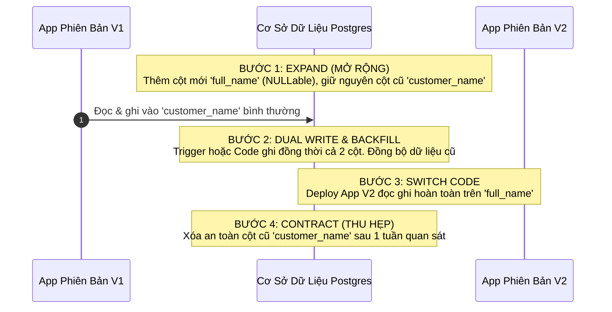

# 07. CHUYỂN ĐỔI CƠ SỞ DỮ LIỆU KHÔNG GIÁN ĐOẠN (ZERO-DOWNTIME MIGRATION VIA EXPAND & CONTRACT PATTERN)
**Phòng Ban:** 07. Quản Trị Cơ Sở Dữ Liệu & Toàn Vẹn Thông Tin (Database Administrator - DBA)  
**Tiêu Chuẩn:** High-Availability Schema Evolution  
**Mục Tiêu:** Nâng cấp cấu trúc bảng dữ liệu trên Production mà không phải dừng server (0 second downtime), không gây khóa bảng (Table Lock) làm gián đoạn việc mua hàng của khách.

---

## 1. NGUY CƠ KHI DÙNG LỆNH ALTER TABLE TRUYỀN THỐNG
Khi một bảng có hàng triệu dòng (hoặc đang nhận lưu lượng truy cập liên tục):
- Lệnh `ALTER TABLE orders RENAME COLUMN customer_name TO full_name` sẽ **KHÓA TOÀN BỘ BẢNG (EXCLUSIVE LOCK)**.
- Mọi request tạo đơn từ khách hàng đều bị treo hoặc timeout 504.
- Nếu code mới deploy gặp lỗi, việc rollback lại database sẽ vô cùng khó khăn.

---

## 2. QUY TRÌNH 4 BƯỚC "MỞ RỘNG VÀ THU HẸP" (EXPAND & CONTRACT PATTERN)

### Các Lệnh Thực Thi Chuẩn:
1. **Bước 1 (Expand):**  
   `ALTER TABLE orders ADD COLUMN full_name VARCHAR(255);` (Cột mới cho phép null -> Không khóa bảng).
2. **Bước 2 (Backfill):**  
   Chạy script chạy ngầm theo từng batch 1000 dòng để copy dữ liệu từ `customer_name` sang `full_name`.
3. **Bước 3 (Deploy V2):**  
   Code mới chuyển sang dùng `full_name`.
4. **Bước 4 (Contract):**  
   `ALTER TABLE orders DROP COLUMN customer_name;`

