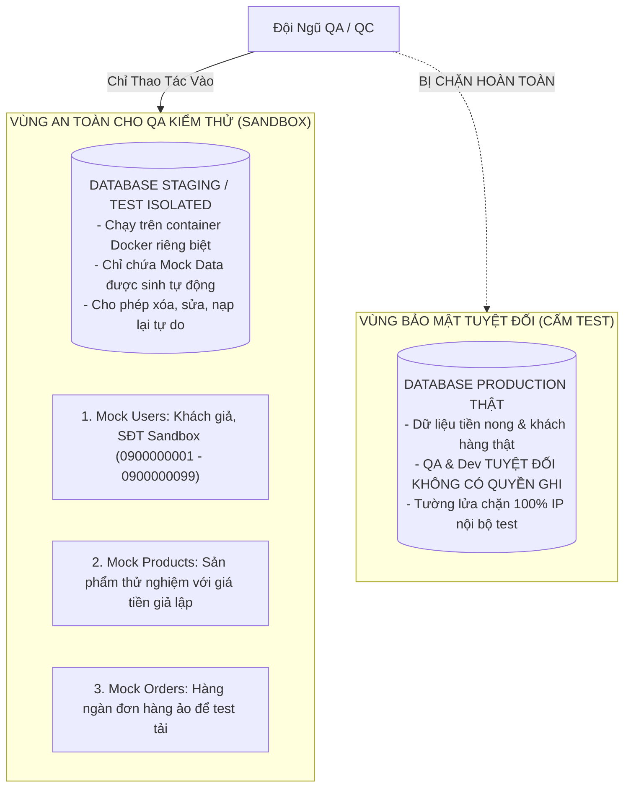

# 03. CHÍNH SÁCH KIỂM THỬ CƠ SỞ DỮ LIỆU AN TOÀN BẰNG DỮ LIỆU MẪU
## (ISOLATED DATABASE TESTING & ZERO-IMPACT MOCK DATA POLICY)

> **"Luật thép" của phòng kiểm thử:** *"Tuyệt đối CẤM 100% việc chạy bất kỳ bài test nào trên Cơ sở dữ liệu thật (Production Database). Mọi bài kiểm thử chức năng, kiểm thử tải và kiểm thử bảo mật CHỈ ĐƯỢC PHÉP thực hiện trên môi trường Sandbox được cô lập hoàn toàn, sử dụng Dữ liệu giả lập (Mock Data / Seed Data) để đảm bảo không làm ô nhiễm, sai lệch hay xóa nhầm dữ liệu khách hàng thật."*

---

## 1. Kiến Trúc Cách Ly 3 Tầng Giữa Mock Data & Production Data



---

## 2. 3 Cơ Chế Đảm Bảo Không Ảnh Hưởng Dữ Liệu Thật (Zero-Impact Mechanisms)

### 🛡️ Cơ Chế 1: Tự Động Thu Hồi Sau Khi Test (Transactional Test with Auto-Rollback)
Đối với các bài kiểm thử tự động (Automation Test) viết bằng Jest hoặc Supertest:
* Mỗi ca kiểm thử được bọc trong một **Database Transaction**:
  1. Bài test bắt đầu ➔ Mở Transaction.
  2. Tạo đơn hàng giả, trừ tồn kho giả lập trong database test.
  3. Kiểm tra kết quả khẳng định (Assert: số dư đúng, đơn hàng sinh mã chuẩn).
  4. Bài test kết thúc ➔ Hệ thống lập tức gọi lệnh **`ROLLBACK`**, cơ sở dữ liệu test trở về nguyên vẹn như trước khi test, không để lại rác dữ liệu.

### 🛡️ Cơ Chế 2: Hộp Cát Thanh Toán Giả Lập (Payment Gateway Mock Sandbox)
* Khi test thanh toán VietQR và VNPay:
  - QA sử dụng tài khoản Ngân hàng Sandbox (Ví dụ: Số thẻ test `9704198526191432198`, OTP cố định `999999`).
  - Tiền trừ chỉ là số ảo trong hệ thống Sandbox của cổng thanh toán, **hoàn toàn không liên quan đến tài khoản ngân hàng thực tế của công ty hay khách hàng**.

### 🛡️ Cơ Chế 3: Kịch Bản Nạp & Làm Sạch Dữ Liệu Tự Động Trong 5 Giây (One-Click DB Reset)
DevOps và DBA đã tạo sẵn lệnh script để QA có thể "tẩy rửa" và nạp lại toàn bộ dữ liệu mock chuẩn bất kỳ lúc nào:
```bash
# Lệnh xóa sạch dữ liệu test và nạp lại 100% Mock Data ban đầu trên môi trường Staging:
npm run db:test:reset
```
Lệnh này tự động thực thi các file:
* [`001_initial_schema_rollback.sql`](file:///d:/DOWNLOAD/IT-Assignment/07_Database_Management/02_migrations_and_seeds/001_initial_schema_rollback.sql): Xóa sạch bảng tạm.
* [`001_initial_schema.sql`](file:///d:/DOWNLOAD/IT-Assignment/07_Database_Management/02_migrations_and_seeds/001_initial_schema.sql): Dựng lại khung bảng trắng.
* [`seed_data_dev.sql`](file:///d:/DOWNLOAD/IT-Assignment/07_Database_Management/02_migrations_and_seeds/seed_data_dev.sql): Nạp sẵn tài khoản mẫu, danh mục mẫu và sản phẩm mẫu để test.

---

## 3. Quy Định Ẩn Danh Dữ Liệu (Data Masking & Anonymization)
Trong trường hợp cần kéo dữ liệu mẫu từ Production về Staging để tái hiện một lỗi hỏng hóc phức tạp:
* DBA bắt buộc phải chạy qua công cụ làm mờ dữ liệu (Data Masking Script):
  - 100% Tên khách hàng đổi thành: `Customer_001`, `Customer_002`...
  - 100% Số điện thoại chuyển thành dạng: `090****123`.
  - 100% Email chuyển thành: `user_masked_***@test.local`.
  - Toàn bộ mật khẩu được ghi đè bằng một mật khẩu mặc định thống nhất.
* Tuyệt đối không để lộ bất kỳ thông tin cá nhân (PII - Personally Identifiable Information) nào của khách hàng thật trên môi trường kiểm thử.

