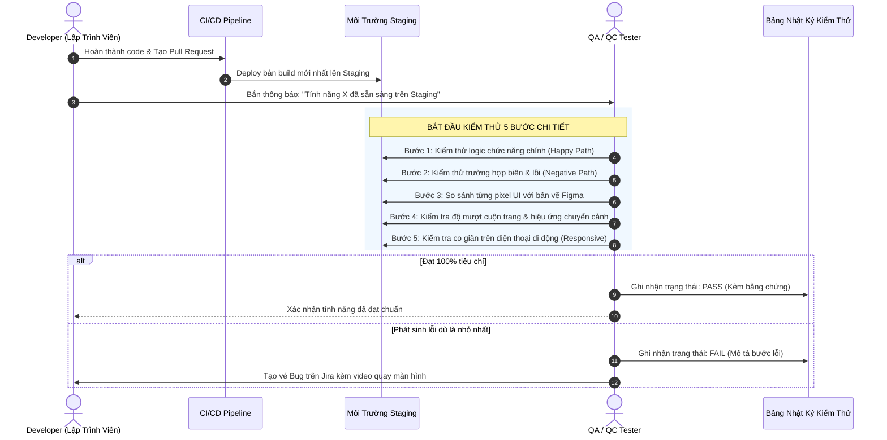

# 01. NHẬT KÝ KIỂM THỬ TỪNG CHỨC NĂNG SAU KHI TRIỂN KHAI
## (STEP-BY-STEP FEATURE VERIFICATION & DAILY TEST RUN LEDGER)

> **Quy tắc bất biến:** *"Ngay khi phòng ban lập trình bàn giao bất kỳ chức năng nào lên môi trường Staging, QA không được kiểm tra qua loa mà phải thực hiện kiểm thử từng bước chi tiết (Step-by-step), kiểm tra toàn diện 5 khía cạnh (Chức năng, UI, UX, Hiệu ứng, Responsive) và ghi chép nhật ký minh bạch: Chức năng nào PASS, chức năng nào FAIL, kèm bằng chứng cụ thể."*

---

## 1. Quy Trình Bàn Giao & Kiểm Thử Tính Năng (Feature Handover Flow)

---

## 2. Bảng Nhật Ký Thực Thi Kiểm Thử Chi Tiết (Execution Run Ledger)

| Mã Tính Năng | Tên Tính Năng & Phân Hệ | Phiên Bản Build | Ngày Test | Người Thực Hiện | Kiểm Thử UI/UX | Kiểm Thử Hiệu Ứng | Kiểm Thử Responsive | Trạng Thái Cuối Cùng | Bằng Chứng / Ghi Chú |
|---|---|:---:|:---:|:---:|:---:|:---:|:---:|:---:|---|
| **FEAT-AUTH-01** | Đăng nhập số điện thoại & nhận OTP SMS | `v1.2.0-stg` | 20/11/2026 | QA Lead | Đạt 100% | Đạt (Popup mượt) | Đạt (iPhone 14 & Galaxy S23) | 🟢 **PASS** | `evidence/auth-otp-pass.mp4` |
| **FEAT-CART-02** | Thêm món hàng & Cập nhật số lượng giỏ | `v1.2.1-stg` | 21/11/2026 | QA Specialist | Đạt 100% | Đạt (Optimistic UI) | Đạt (iPad Pro & Mobile) | 🟢 **PASS** | `evidence/cart-qty-pass.png` |
| **FEAT-PAY-03** | Hiển thị mã VietQR & Đếm ngược 10 phút | `v1.2.3-stg` | 22/11/2026 | QA Specialist | Chưa đạt | Đạt (Đồng hồ chạy) | Chưa đạt (Bị tràn màn hình 375px) | 🔴 **FAIL** | **BUG-089:** Lệch 4px lề phải trên iPhone SE |
| **FEAT-FILTER-04**| Bộ lọc đa tiêu chí (Giá, Thương hiệu, Màu) | `v1.2.4-stg` | 23/11/2026 | QA Specialist | Đạt 100% | Đạt (Trượt mượt) | Đạt (Mobile Drawer) | 🟢 **PASS** | `evidence/filter-pass.mp4` |
| **FEAT-SEARCH-05**| Tìm kiếm gợi ý tự động (Typeahead Search)| `v1.2.5-stg` | 24/11/2026 | QA Lead | Đạt 100% | Đạt (Debounce 300ms)| Đạt | 🟢 **PASS** | `evidence/search-pass.png` |

---

## 3. Biểu Mẫu Ghi Chép Kiểm Thử Từng Bước (Step-by-Step Test Sheet Mẫu)

### Nhật Ký Tính Năng: `FEAT-AUTH-01` - Đăng Nhập OTP SMS
* **Môi trường kiểm thử:** Staging Server (`https://staging.domain.com/login`)
* **Thiết bị thử nghiệm:** 
  - Máy tính: macOS Chrome v128 (Màn hình 1440x900)
  - Điện thoại: iPhone 14 Pro (iOS 17.5 Safari) & Xiaomi Redmi Note 12 (Android 13 Chrome)

#### Trình Tự Kiểm Thử Từng Bước:
1. **Bước 1 (Kiểm tra giao diện ban đầu - GUI Check):**
   - *Hành động:* Truy cập trang `/login`.
   - *Kiểm tra:* Màu nút bấm đúng mã `#2563EB`, font chữ `Plus Jakarta Sans`, các ô nhập liệu thẳng hàng, không bị méo mó.
   - *Kết quả:* ✅ **PASS**
2. **Bước 2 (Kiểm tra nhập liệu hợp lệ - Happy Path):**
   - *Hành động:* Nhập số điện thoại `0901234567` và bấm "Nhận mã OTP".
   - *Kiểm tra:* Nút chuyển sang trạng thái Loading (có con xoay Spinner trong 1 giây), hiển thị 6 ô nhập mã OTP rõ ràng.
   - *Kết quả:* ✅ **PASS**
3. **Bước 3 (Kiểm tra hiệu ứng & Trải nghiệm - Motion & UX):**
   - *Hành động:* Nhập đúng mã OTP `999999`.
   - *Kiểm tra:* Hệ thống chuyển trang êm ái sang Trang chủ, xuất hiện thông báo Toast chúc mừng góc phải mượt mà trong 300ms, không bị trắng màn hình giật cục.
   - *Kết quả:* ✅ **PASS**
4. **Bước 4 (Kiểm tra tương thích di động - Responsive):**
   - *Hành động:* Mở trên điện thoại di động iPhone màn hình nhỏ (375px), bàn phím ảo nhảy lên.
   - *Kiểm tra:* Bàn phím số tự động mở (thuộc tính `inputmode="numeric"`), nút "Xác nhận" tự động đẩy lên trên bàn phím, không bị che khuất.
   - *Kết quả:* ✅ **PASS**

