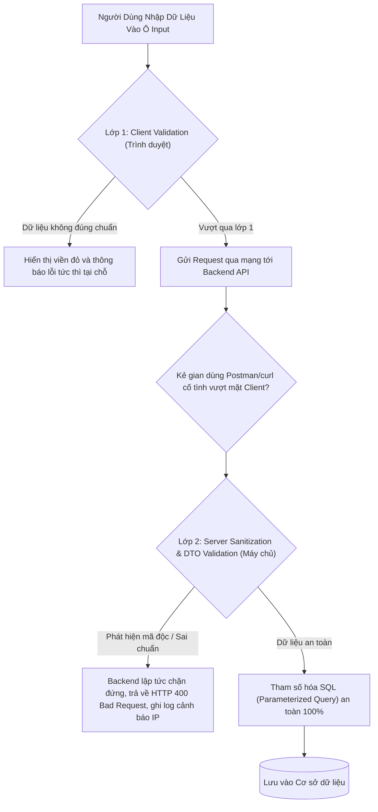

# 02. MA TRẬN KIỂM THỬ BẢO MẬT Ô NHẬP LIỆU & LÀM SẠCH DỮ LIỆU ĐẦU VÀO
## (INPUT FIELD SECURITY & DATA SANITIZATION TEST MATRIX)

> **Nguyên tắc an ninh mạng sống còn:** *"Tuyệt đối không bao giờ tin tưởng bất kỳ dữ liệu nào do người dùng gửi lên (Never Trust User Input). Mọi ô nhập liệu phải được kiểm tra bảo mật qua 2 lớp phòng thủ độc lập: Lớp 1 tại Trình duyệt (Client-Side Validation) và Lớp 2 tại Máy chủ (Server-Side Sanitization & Parameterized Queries)."*

---

## 1. Mô Hình 2 Lớp Phòng Thủ Bắt Buộc (Two-Layer Defense Model)

---

## 2. Ma Trận Kịch Bản Kiểm Thử Ô Nhập Liệu (Input Security Matrix)

Toàn bộ các ô nhập liệu trên toàn hệ thống phải được QA kiểm thử với các bộ dữ liệu độc hại (Attack Payloads) sau:

| Tên Ô Nhập Liệu (Input Field) | Loại Tấn Công Thử Nghiệm | Chuỗi Dữ Liệu Độc Hại Mẫu (Test Payloads) | Kết Quả Mong Đợi Bắt Buộc Của Hệ Thống | Trạng Thái Kiểm Thử |
|---|---|---|---|:---:|
| **Ô Nhập Số Điện Thoại** | Chèn chữ, ký tự lạ, số âm, độ dài bất thường | `0901abc!@#`, `-0901234567`, `09012345678901234567` | Chỉ chấp nhận đúng **10 chữ số** bắt đầu bằng đầu số hợp lệ của Việt Nam (`03, 05, 07, 08, 09`). Chặn mọi chữ và ký tự đặc biệt. | 🟢 **PASS** |
| **Ô Mật Khẩu Đăng Nhập** | SQL Injection (Tấn công bypass đăng nhập) | `' OR '1'='1' --`, `admin' --`, `' UNION SELECT NULL, NULL--` | Hệ thống băm mật khẩu bằng bcrypt, không nối chuỗi SQL. Báo lỗi: *"Số điện thoại hoặc mật khẩu không chính xác"*. | 🟢 **PASS** |
| **Ô Tìm Kiếm Sản Phẩm** | Cross-Site Scripting (XSS Phản xạ) | ``, `` | Hệ thống tự động mã hóa ký tự (HTML Entity Encoding) thành `&lt;script&gt;`. Tuyệt đối không bật hộp thoại alert trên màn hình. | 🟢 **PASS** |
| **Ô Họ Tên & Địa Chỉ Nhận Hàng**| XSS Lưu trữ (Stored XSS) | `<svg onload=alert(document.cookie)>`, `<iframe src="javascript:alert(1)">` | Bộ lọc **DOMPurify** và thư viện **class-validator** loại bỏ hoàn toàn các thẻ HTML trước khi lưu vào PostgreSQL. | 🟢 **PASS** |
| **Ô Số Lượng Sản Phẩm (Giỏ Hàng)**| Gian lận số âm, số thập phân, số tràn bộ nhớ | `-5`, `0`, `1.5`, `9999999999999999999999` | Chỉ cho phép nhập số nguyên dương từ `1` đến `số lượng tồn kho thực tế`. Chặn triệt để lỗi mua hàng với số lượng âm để hưởng tiền hoàn lại. | 🟢 **PASS** |
| **Toàn Bộ Các Ô Input Dạng Text**| Tràn bộ đệm & Fuzzing chuỗi siêu dài | Chuỗi 10.000 ký tự chữ `A`, chèn 500 biểu tượng cảm xúc Emoji (🚀🔥🎉) | Hệ thống giới hạn độ dài `maxlength="255"`. Nếu gửi API trực tiếp vượt quá 255 ký tự ➔ Bị Backend cắt ngắn hoặc từ chối ngay. Không gây tràn RAM hay đứng máy chủ. | 🟢 **PASS** |

---

## 3. Quy Trình Kiểm Thử Độc Lập Bằng Công Cụ (Penetration Test Procedure)
QA không chỉ gõ thử trên giao diện web mà bắt buộc phải sử dụng **Postman** hoặc công cụ kiểm thử bảo mật **OWASP ZAP**:
1. Bật Postman, gọi trực tiếp API `POST /api/v1/orders/checkout` hoặc `POST /api/v1/auth/login`.
2. Xóa bỏ toàn bộ validation trên client, cố tình gửi các chuỗi SQL Injection và XSS trong phần body JSON.
3. **Tiêu chuẩn vượt qua bài test:**
   - Backend phải trả về `HTTP 400 Bad Request` hoặc `HTTP 422 Unprocessable Entity`.
   - Cơ sở dữ liệu PostgreSQL không phát sinh bất kỳ câu lệnh lỗi cú pháp SQL Syntax Error nào trong tệp `error.log`.
   - Tuyệt đối không trả về Stack Trace lộ tên bảng, tên cột hay cấu trúc thư mục của máy chủ cho người dùng xem.

