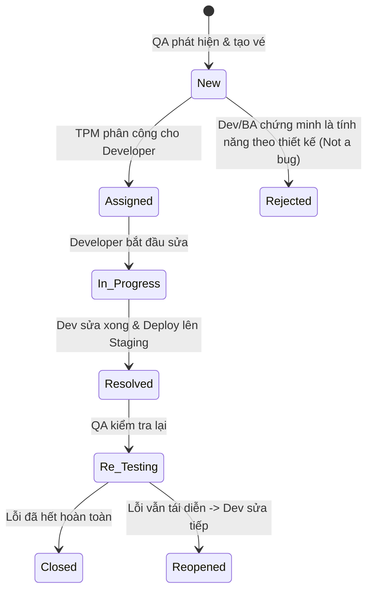

# VÒNG ĐỜI LỖI & MA TRẬN MỨC ĐỘ NGHIÊM TRỌNG (DEFECT LIFECYCLE)

## 1. Vòng Đời Trạng Thái Lỗi (Defect Lifecycle State Diagram)

---

## 2. Ma Trận Đánh Giá Mức Độ Nghiêm Trọng (Severity vs Priority)

| Mức Độ Nghiêm Trọng (Severity) | Định Nghĩa Kỹ Thuật | Thời Gian Sửa Chữa Bắt Buộc (SLA) | Độ Ưu Tiên (Priority) |
|---|---|:---:|:---:|
| **Blocker (S1)** | Sập server, không thể thanh toán, mất tiền người dùng, rò rỉ dữ liệu thẻ | **Dưới 2 giờ** | **P1 (Highest)** |
| **Critical (S2)** | Tính năng chính tê liệt (ví dụ không thể lọc sản phẩm) nhưng có cách đi đường vòng | **Dưới 8 giờ** | **P1 / P2** |
| **Major (S3)** | Chức năng phụ lỗi (ví dụ không tải được ảnh avatar), tính toán khuyến mãi làm tròn sai 100đ | **Trong vòng 48 giờ** | **P3 (Medium)** |
| **Minor / Trivial (S4)** | Lỗi chính tả, sai lệch 2px lề so với bản vẽ Figma, màu chữ hơi nhạt | **Xử lý vào cuối Sprint** | **P4 (Low)** |

