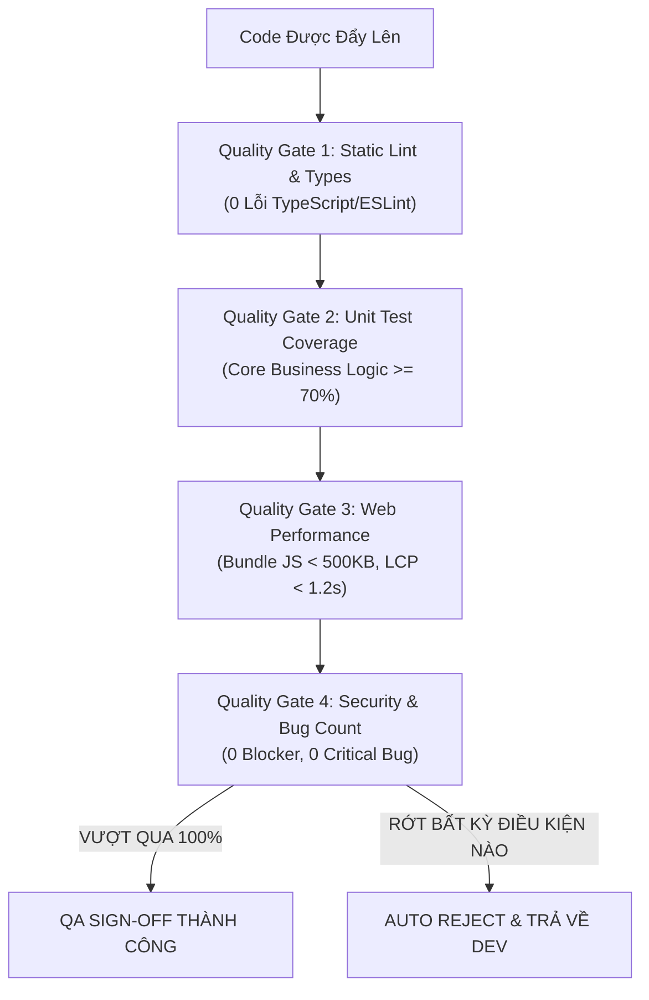

# 05. CỔNG CHẤT LƯỢNG TỰ ĐỘNG & TIÊU CHÍ KẾT THÚC KIỂM THỬ (AUTOMATED QUALITY GATES & EXIT CRITERIA)
**Phòng Ban:** 08. Kiểm Định & Đảm Bảo Chất Lượng (Quality Assurance - QA/QC)  
**Tiêu Chuẩn:** ISO/IEC/IEEE 29119 Software Testing Standard & Automated Quality Gate  
**Mục Tiêu:** Đặt ra các ranh giới chất lượng không thể thỏa hiệp trước khi cho phép một tính năng được ký nghiệm thu.

---

## 1. KHÁI NIỆM QUALITY GATE (CỔNG CHẤT LƯỢNG)
Không còn tình trạng "Dev bảo xong thì QA cho qua". Hệ thống kiểm định dựa trên bộ chỉ số định lượng bắt buộc:

---

## 2. MA TRẬN TIÊU CHÍ KẾT THÚC KIỂM THỬ (EXIT CRITERIA MATRIX)

| Tiêu Chí Đánh Giá | Ngưỡng Tối Thiểu Bắt Buộc | Phương Pháp Đo Lường |
| :--- | :--- | :--- |
| **Độ phủ kiểm thử đơn vị (Unit Test Coverage)** | **>= 70%** đối với Core Logic (Tính tiền giỏ hàng, sinh mã VietQR, xác thực auth) | Jest / Vitest Coverage Report |
| **Số lượng lỗi nghiêm trọng (Bug Count)** | **0 Blocker, 0 Critical, 0 Major Bug** | Issue Tracker / Bug Log |
| **Kích thước gói Frontend (Bundle Size)** | **< 500 KB** (Gzip/Brotli) để tải nhanh trên mạng di động | Webpack / Vite Bundle Analyzer |
| **Độ trễ phản hồi giao diện (INP)** | **< 200 ms** (Mọi nút bấm phải phản hồi tức thì) | Chrome Performance Profiler |
| **Tính tương thích đa thiết bị** | **100% không tràn ngang (Horizontal Scrollbar)** trên màn hình 390px | Mobile Device Viewport Matrix |
