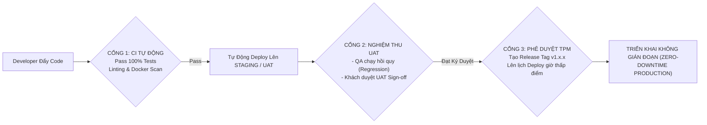

# 02. QUY TRÌNH TRIỂN KHAI AN TOÀN TUYỆT ĐỐI & KỊCH BẢN TỰ ĐỘNG ROLLBACK
## (SAFE ZERO-DOWNTIME DEPLOYMENT & 60-SECOND ROLLBACK PROTOCOL)

> **Nguyên tắc triển khai:** *"Một lần deploy thành công là một lần deploy mà người dùng đang mua sắm không hề nhận ra hệ thống vừa được nâng cấp. Không được có màn hình lỗi 502 Bad Gateway, không làm đứt kết nối giỏ hàng, và luôn có sẵn phanh khẩn cấp để quay ngược thời gian (Rollback) trong vòng 60 giây nếu phát sinh sự cố."*

---

## 1. Cổng Kiểm Soát 3 Tầng Trước Khi Lên Production (Deployment Gates)



---

## 2. Chiến Lược Triển Khai Không Gián Đoạn (Rolling Update & Health Check)

Để đảm bảo người dùng đang lướt web không bị văng session:
1. **Bước 1 (Kéo bản mới):** Máy chủ Production tải Docker Image mới nhất về nhưng **chưa cho nhận lưu lượng mạng**.
2. **Bước 2 (Khởi động container mới):** Container mới được khởi động trên cổng mạng nội bộ phụ (ví dụ port 3001).
3. **Bước 3 (Kiểm tra sức khỏe - Healthcheck Loop):** Nginx gửi liên tục 5 request kiểm tra vào endpoint `/api/health` của container mới:
   - Nếu trả về `HTTP 200 OK` (Cơ sở dữ liệu đã kết nối, Redis đã thông suốt) ➔ Container mới chính thức **SẴN SÀNG**.
4. **Bước 4 (Đảo luồng êm ái - Traffic Cutover):** Nginx nạp lại cấu hình bằng lệnh `nginx -s reload` (hoàn tất trong 0.05 giây), chuyển toàn bộ khách hàng sang container mới.
5. **Bước 5 (Tắt container cũ):** Sau khi các request cũ xử lý xong hoàn toàn (Graceful Shutdown trong 30 giây), container cũ mới chính thức dừng hoạt động.

---

## 3. Kịch Bản Tự Động Hoàn Tác Trong 60 Giây (60-Second Rollback Protocol)

Nếu ngay sau khi deploy, hệ thống giám sát (Prometheus/Sentry) phát hiện:
* Tỷ lệ lỗi `HTTP 5xx > 1%` trong 2 phút liên tiếp, HOẶC
* Thời gian phản hồi API vọt lên `> 2.000ms`.

➔ **Hệ thống tự động kích hoạt Script Hoàn Tác Khẩn Cấp:**

```bash
#!/bin/bash
# ========================================================
# KỊCH BẢN ROLLBACK KHẨN CẤP TRONG 60 GIÂY (RUNBOOK SCRIPT)
# ========================================================
set -e

PREVIOUS_TAG=$(cat /opt/enterprise-app/.last_stable_tag)
echo "🚨 PHÁT HIỆN LỖI CAO ĐIỂM! Bắt đầu khôi phục phiên bản ổn định gần nhất: ${PREVIOUS_TAG}..."

# 1. Chuyển đổi image về tag ổn định trước đó
sed -i "s/backend-core:.*/backend-core:${PREVIOUS_TAG}/g" /opt/enterprise-app/docker-compose.production.yml

# 2. Khởi động lại container bản cũ ngay lập tức
docker compose -f /opt/enterprise-app/docker-compose.production.yml up -d --no-deps backend-core

# 3. Nạp lại Nginx Reverse Proxy
docker exec enterprise-nginx nginx -s reload

# 4. Gửi cảnh báo khẩn cấp tới nhóm Telegram
curl -s -X POST https://api.telegram.org/bot${TELEGRAM_BOT_TOKEN}/sendMessage \
  -d chat_id=${TELEGRAM_CHAT_ID} \
  -d text="⚠️ [CẢNH BÁO TỰ ĐỘNG ROLLBACK] Hệ thống Production đã tự động hoàn tác về bản ổn định ${PREVIOUS_TAG} trong 45 giây! Đội ngũ Backend và QA kiểm tra ngay nguyên nhân lỗi."

echo "✅ Khôi phục thành công! Hệ thống đã an toàn trở lại."
```

