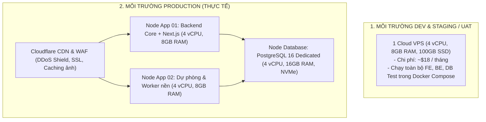

# 01. ĐỀ XUẤT HẠ TẦNG MÁY CHỦ CHẠY MƯỢT & TỐI ƯU CHI PHÍ NHẤT
## (COST-EFFECTIVE SERVER ARCHITECTURE & CAPACITY PLANNING)

> **Phương châm DevOps:** *"Không dùng 'dao mổ trâu để giết gà', nhưng cũng không để hệ thống bị nghẽn vì hạ tầng quá yếu. Đội ngũ DevOps luôn tính toán để máy chủ chạy mượt mà 24/7 dưới tải trọng đỉnh, trong khi ngân sách hàng tháng được tối ưu hóa đến từng đồng cho doanh nghiệp."*

---

## 1. So Sánh 3 Phương Án Hạ Tầng Theo Bài Toán Chi Phí & Hiệu Năng

Dựa trên yêu cầu của phòng Kiến trúc & Quản trị dự án đề xuất xuống, DevOps đưa ra 3 phương án để lựa chọn:

| Tiêu Chí So Sánh | Phương Án 1: Cloud VPS Tối Ưu (Hetzner / OVH / DigitalOcean) | Phương Án 2: Hyperscale Cloud (AWS / Google Cloud Platform) | Phương Án 3: Hybrid Tối Ưu (VPS Compute + Cloudflare Edge) **[KHUYẾN NGHỊ]** |
|---|---|---|---|
| **Mức độ phù hợp** | Giai đoạn khởi đầu, ngân sách tiết kiệm | Doanh nghiệp toàn cầu, yêu cầu tuân thủ phức tạp | **Cân bằng hoàn hảo: Chi phí rẻ, tốc độ toàn cầu, chịu tải 5.000 CCU** |
| **Chi phí dự kiến / tháng** | $45 - $80 / tháng | $350 - $800 / tháng | **$65 - $110 / tháng (Tiết kiệm 75% so với AWS)** |
| **Tốc độ xử lý (CPU/RAM)** | Cực mạnh (Dedicated AMD EPYC / NVMe SSD) | Phụ thuộc gói (Thường bị giới hạn Burstable CPU credits) | Cực mạnh trên VPS gốc + Đệm siêu tốc trên mạng lưới 300 thành phố của Cloudflare |
| **Chi phí truyền tải (Bandwidth)** | 20TB miễn phí / tháng | $0.09 / GB (Rất đắt khi có nhiều ảnh) | Miễn phí 100% băng thông qua Cloudflare CDN |

---

## 2. Bảng Phân Bổ Cấu Hình Máy Chủ Chi Tiết Cho 3 Môi Trường

### Chi Tiết Cấu Hình Production Đề Xuất (Tổng Ngân Sách: ~$85 USD / tháng):
1. **Tầng phân phối & Lá chắn (Edge Tier):** Dùng gói **Cloudflare Free/Pro ($0 - $20/tháng)**. Đảm nhiệm việc chặn tấn công DDoS, tự động nén ảnh WebP, lưu cache toàn bộ file tĩnh (JS/CSS/Ảnh sản phẩm) ngay tại Việt Nam giúp người dùng mở trang trong **< 0.5 giây**.
2. **Tầng máy chủ ứng dụng (Application Tier):** 2 Cloud VPS chạy Docker song song ($25/tháng x 2 = $50/tháng). Đáp ứng mượt mà 750 Requests/giây (RPS) vào giờ cao điểm.
3. **Tầng dữ liệu (Database Tier):** 1 Cloud VPS chuyên dụng 16GB RAM ($30/tháng). Sử dụng 100% ổ cứng SSD NVMe tốc độ đọc ghi 3.000 MB/s, đảm bảo mọi câu truy vấn được xử lý ngay trong bộ nhớ đệm RAM.

---

## 3. Chiến Lược Cắt Giảm Chi Phí Tự Động (FinOps Best Practices)
* **Tự động tắt môi trường Dev/UAT ngoài giờ làm việc:** Môi trường Test của lập trình viên được lên lịch tự động tắt vào lúc 20:00 tối và tự bật lại vào 08:00 sáng từ Thứ Hai đến Thứ Sáu, **tiết kiệm ngay 35% chi phí điện toán hàng tháng**.
* **Xóa bỏ các bản sao lưu cũ:** Script tự động dọn dẹp các bản snapshot lưu quá 30 ngày trên Cloud Storage để không bị âm thầm trừ tiền dung lượng rác.

