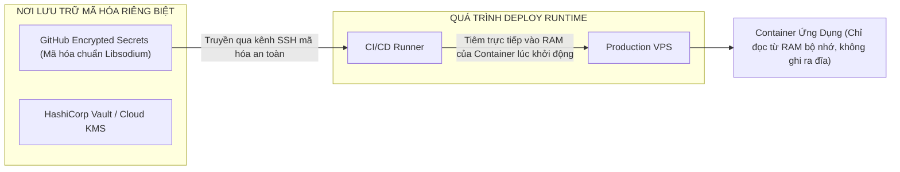

# 03. CHÍNH SÁCH BẢO MẬT TUYỆT ĐỐI CÁC KHÓA BÍ MẬT & API KEYS
## (ZERO-TRUST SECRETS MANAGEMENT & KEY ROTATION POLICY)

> **Luật bất thành văn của DevOps:** *"Một chìa khóa bí mật (Secret Key) bị lộ trên Git đồng nghĩa với việc toàn bộ cổng thành đã mở toang cho tin tặc. DevOps áp dụng triết lý Zero-Trust: Không bao giờ tin tưởng, luôn luôn xác thực và không bao giờ lưu trữ khóa ở dạng văn bản thô (Plaintext)."*

---

## 1. 5 "Tội Lỗi Chết Người" Cấm Tuyệt Đối Trong Dự Án (The 5 Sins)

1. ❌ **CẤM commit file `.env` hoặc chứa chuỗi secret lên Git:** Dù là repo riêng tư (Private Repo) cũng tuyệt đối không commit. Nếu một lập trình viên vô tình commit file chứa API Key ➔ Khóa đó coi như **ĐÃ BỊ XÂM PHẠM (COMPROMISED)** và bắt buộc phải hủy (Revoke) lập tức.
2. ❌ **CẤM in Secret Key ra Console Log (`console.log(process.env)`):** Log hệ thống được đẩy về các dịch vụ như Sentry hay Grafana Loki. Nếu log chứa Secret Key, toàn bộ nhân sự có quyền xem log đều có thể thấy.
3. ❌ **CẤM gửi Secret Key qua tin nhắn thường (Zalo, Skype, Facebook):** Nếu cần bàn giao mật khẩu máy chủ, bắt buộc dùng các công cụ mã hóa tự hủy (1Password, Bitwarden, hoặc Pastebin có mật khẩu tự xóa sau 1 lần mở).
4. ❌ **CẤM để lộ Secret Key xuống mã nguồn Frontend:** Các biến như `JWT_ACCESS_SECRET`, `DATABASE_PASSWORD`, `STRIPE_SECRET_KEY` chỉ được tồn tại trên máy chủ Backend. Frontend tuyệt đối không bao giờ được chứa các biến này trong bundle code gửi xuống trình duyệt.
5. ❌ **CẤM dùng chung một bộ Key cho cả Staging và Production:** Khóa bí mật của Production phải là duy nhất và tách biệt 100% với môi trường Test.

---

## 2. Quy Trình Lưu Trữ & Tiêm Biến Môi Trường Khi Deploy (Secrets Injection)



### Cơ Chế Tiêm Bí Mật Runtime Bằng Docker Secrets:
* Thay vì để file `.env` nằm lộ thiên trên ổ đĩa máy chủ, các biến nhạy cảm được nạp qua cơ chế **Docker Secrets** hoặc mount từ một thư mục chỉ định có quyền hạn chế nghiêm ngặt:
  ```bash
  # Chỉ cấp quyền đọc cho duy nhất user quản trị hệ thống (Root 600)
  chmod 600 /opt/enterprise-app/.env.production
  chown root:root /opt/enterprise-app/.env.production
  ```

---

## 3. Chính Sách Xoay Vòng Khóa Định Kỳ (Key Rotation Policy)
* **Tần suất xoay vòng:** Toàn bộ `JWT_ACCESS_SECRET`, mật khẩu Database và API Key bên thứ ba (SMS Gateway, Cổng thanh toán) bắt buộc phải được xoay vòng (Đổi mới) định kỳ **mỗi 90 ngày**.
* **Kịch bản xử lý khi phát hiện lộ Key (Emergency Revocation Runbook):**
  1. *Phút thứ 1:* Vô hiệu hóa ngay lập tức Key cũ trên trang quản trị đối tác (VNPay, Twilio, AWS).
  2. *Phút thứ 3:* Sinh Key mới và cập nhật vào GitHub Secrets / Máy chủ Production.
  3. *Phút thứ 5:* Khởi động lại container Backend để nhận Key mới.
  4. *Phút thứ 15:* Rà soát nhật ký truy cập (Access Log) để kiểm tra xem tin tặc đã kịp thực hiện hành vi gian lận nào trong khoảng thời gian lộ Key hay chưa.

