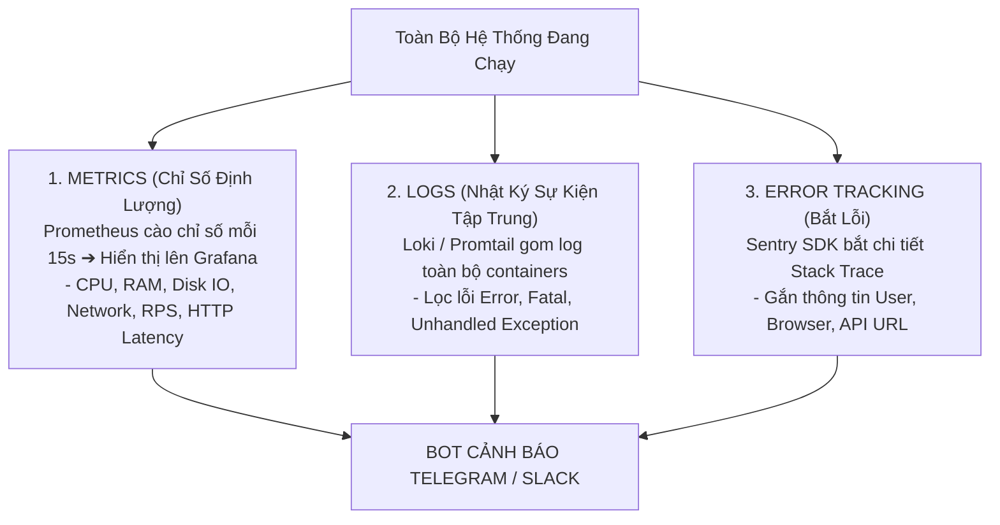

# HƯỚNG DẪN THIẾT LẬP HỆ THỐNG GIÁM SÁT TOÀN DIỆN (OBSERVABILITY STACK)

## 1. 3 Trụ Cột Giám Sát (Metrics, Logs, Traces)



---

## 2. Kịch Bản Bot Bắn Cảnh Báo Telegram (Alertmanager Webhook)
Khi một trong các điều kiện sau xảy ra trong vòng 2 phút liên tục:
1. CPU máy chủ chạm ngưỡng **> 85%**.
2. Dung lượng ổ đĩa SSD trống còn lại **< 15%**.
3. Tỷ lệ lỗi HTTP 5xx trả về từ Nginx **> 2%**.
4. Thời gian phản hồi API P95 **> 500ms**.

➔ Alertmanager tự động kích hoạt Webhook bắn thông điệp SOS khẩn cấp tới nhóm Telegram trực chiến:
```
🚨 [CẢNH BÁO KHẨN CẤP - SEV-1]
Máy Chủ: Production-Node-01
Nguyên nhân: CPU đạt 91.4% trong 3 phút liên tục.
Số request: 840 RPS (Đột biến do Flash-sale).
Hành động đề xuất: Kiểm tra auto-scaling hoặc kiểm tra câu lệnh SQL bị nghẽn!
```

