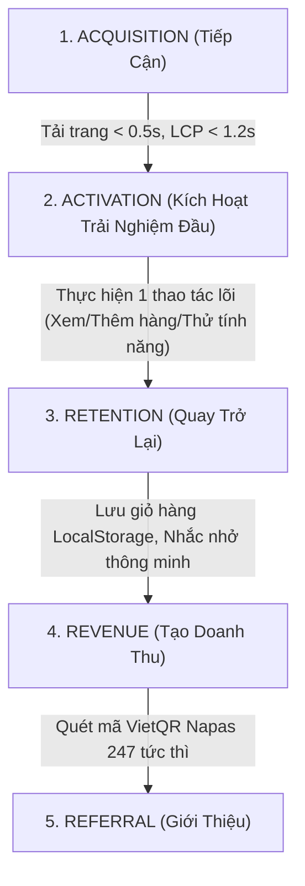

# 03. CHỈ SỐ BẮC ĐẨU (NORTH STAR METRIC) & KHUNG KPI THÀNH CÔNG (SUCCESS KPI FRAMEWORK)
**Phòng Ban:** 10. Quản Lý Sản Phẩm (Product Management - PO)  
**Tiêu Chuẩn:** Data-Driven Product Strategy (Đo lường giá trị thực tế sau bàn giao)

---

## 1. KHÁI NIỆM NORTH STAR METRIC (CHỈ SỐ BẮC ĐẨU)
Mỗi dự án phần mềm tạo ra không được đánh giá bằng "bao nhiêu dòng code đã viết", mà bằng **Giá trị cốt lõi mang lại cho người dùng và chủ doanh nghiệp**.

### Bảng Chỉ Số Bắc Đẩu Theo Từng Loại Hình Sản Phẩm

| Loại Hình Dự Án | Chỉ Số Bắc Đẩu (North Star Metric) | Chỉ Số Bổ Trợ (Input Metrics) | Cảnh Báo Sức Khỏe (Health Metric) |
| :--- | :--- | :--- | :--- |
| **E-Commerce / Sàn Bán Lẻ** | Tổng giá trị giao dịch thành công (GMV) / Tuần | - Tỷ lệ thêm giỏ hàng (Add-to-cart rate > 8%) - Tỷ lệ quét VietQR thành công (> 92%) | Tỷ lệ hủy đơn hoặc rớt mạng thanh toán < 1% |
| **Phần Mềm B2B SaaS / Quản Trị** | Tần suất thao tác nghiệp vụ cốt lõi (Weekly Active Core Actions) | - Tỷ lệ nhân viên hoàn thành task hàng ngày - Thời gian thao tác 1 đơn xuất kho (< 10s) | Tỷ lệ crash / lỗi 500 = 0% |
| **Dịch Vụ Đặt Lịch / Phòng Khám** | Số lượt khám hoàn thành có đánh giá hài lòng | - Tỷ lệ chọn khung giờ trống thành công - Thời gian phản hồi xác nhận qua SMS (< 30s) | Tỷ lệ No-Show (bỏ hẹn) < 5% |

---

## 2. 4 TẦNG KPI ĐO LƯỜNG VÒNG ĐỜI SẢN PHẨM (AARRR CHO TIER-1 MVP)

1. **Activation Rate (Tỷ lệ kích hoạt):**  
   - Đo lường người dùng vào web có thực hiện ít nhất 1 thao tác (bấm danh mục, xem sản phẩm, thử demo) trong vòng 5 giây đầu tiên. Mục tiêu: **>= 65%**.
2. **Drop-off Funnel (Phễu rơi rụng):**  
   - Theo dõi từng bước: Trang chủ -> Chi tiết sản phẩm -> Giỏ hàng -> Quét QR Thanh toán -> Hoàn tất.  
   - Bất kỳ bước nào rơi rụng > 30% đều phải được PO chỉ định UI/UX và FE thiết kế lại ngay lập tức.
3. **Churn Prevention (Ngăn chặn rời bỏ):**  
   - Giữ trạng thái giỏ hàng trong `localStorage` ngay cả khi người dùng tắt trình duyệt và mở lại.

