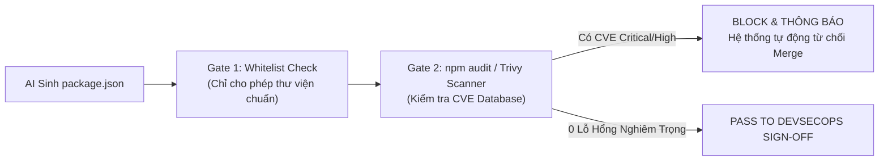

# 01. BẢO MẬT CHUỖI CUNG ỨNG MÃ NGUỒN & QUÉT LỖ HỔNG CVE (SOFTWARE SUPPLY CHAIN & CVE SCANNING POLICY)
**Phòng Ban:** 11. An Toàn Thông Tin Ứng Dụng (Application Security - DevSecOps)  
**Tiêu Chuẩn:** OWASP Top 10 A06:2021 (Vulnerable and Outdated Components) & Zero-Day Defense  
**Mục Tiêu:** Ngăn chặn các thư viện bên thứ 3 chứa mã độc, backdoor hoặc lỗ hổng bảo mật nghiêm trọng (RCE, Prototype Pollution) xâm nhập vào sản phẩm.

---

## 1. RỦI RO LỚN NHẤT KHI DÙNG AI GEN CODE
Khi lập trình viên hoặc AI Vibe Code tự động viết `package.json`, AI thường có thói quen:
- Gọi các package cũ dính lỗ hổng CVE cao/nghiêm trọng (High/Critical).
- Bị ảo giác sinh ra package không tồn tại (Package Hallucination), tạo cơ hội cho tin tặc đăng ký package độc hại (Typosquatting attack).
- Kéo hàng trăm dependency con không cần thiết làm tăng bề mặt tấn công.

---

## 2. QUY TRÌNH QUÉT CVE BẮT BUỘC (SUPPLY CHAIN SCANNING GATES)

### Danh Mục Các Thư Viện Được Xác Thực Chuẩn (Curated Whitelist)
Hệ thống AI chỉ được phép import các package có danh tiếng cao và không dính CVE:
1. **Frontend:** `react`, `react-dom`, `lucide-react`, `tailwindcss`, `clsx`, `tailwind-merge`.
2. **Backend:** `express`, `cors`, `helmet`, `zod`, `dotenv`, `ioredis`, `pg`, `jszip`.
3. **Bảo Mật:** `bcryptjs`, `jsonwebtoken`, `express-rate-limit`.

> **Chính sách DevSecOps:** Mọi package lạ nằm ngoài Whitelist hoặc có điểm CVSS >= 7.0 sẽ bị Policy Gate tự động **BLOCK** và yêu cầu AI thay thế bằng vanilla JS hoặc thư viện an toàn.

