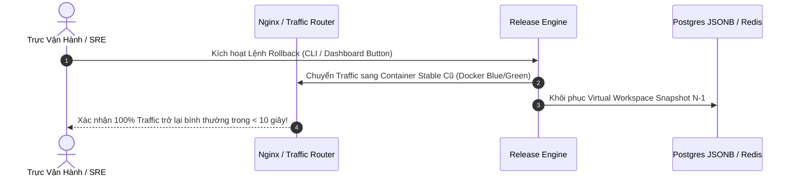

# 03. SỔ TAY KHÔI PHỤC KHẨN CẤP TRONG 30 GIÂY (30-SECOND RAPID ROLLBACK RUNBOOK)
**Phòng Ban:** 12. Quản Lý Phát Hành & Nghiệm Thu (Release Management & UAT Coordinator)  
**Tiêu Chuẩn:** High-Availability Emergency Rollback SOP  
**Mục Tiêu:** Đảm bảo khi phát sinh sự cố nghiêm trọng trên Production (Zero-Day exploit, crash hàng loạt), hệ thống có thể lùi về phiên bản an toàn trước đó trong vòng dưới 30 giây.

---

## 1. NGUYÊN TẮC ROLLBACK "KHÔNG CHẠM VÀO BUILD LẠI"
Một lỗi sai phổ biến là khi hệ thống bị sập thì vội vàng mở máy chủ ra gõ lệnh build lại code. Việc này tốn từ 5 đến 15 phút và rất dễ gây hoảng loạn.

> **Quy tắc Tier-1:** Mọi bản phát hành đều giữ lại Artifact Docker Image hoặc Snapshot JSONB phiên bản trước đó (`git tag` hoặc `release_v1_backup`). Khôi phục bằng cách **CHỈ ĐỔI CON TRỎ (SWITCH POINTER)**.

---

## 2. QUY TRÌNH THỰC THI 3 BƯỚC KHÔI PHỤC (30s ACTION PLAN)



### Các Lệnh Rollback Tức Thì:
1. **Đối với Docker Application:**
   ```bash
   # Chuyển ngay sang image tag stable trước đó
   docker compose stop app && docker run -d --name app_stable it_assignment:v1.2.0
   ```
2. **Đối với Virtual Code Workspace (Zero-Load DB):**
   ```sql
   -- Khôi phục cây file mã nguồn phiên bản an toàn gần nhất
   UPDATE projects 
   SET files = previous_stable_files, status = 'ACTIVE' 
   WHERE id = 'PRJ-2026-PRODUCTION';
   ```
3. **Kiểm tra trạng thái sau 5 giây:**
   - Gửi request `GET /health` -> Trả về HTTP 200 OK.

