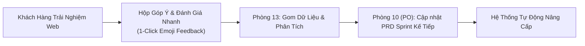

# 03. CAM KẾT CHẤT LƯỢNG DỊCH VỤ HẬU PHÁT HÀNH & PHỄU PHẢN HỒI (POST-LAUNCH SLA & CUSTOMER FEEDBACK FUNNEL)
**Phòng Ban:** 13. Đo Lường Hành Vi & Vận Hành Hậu Phát Hành (Product Analytics & Post-Launch Support)  
**Tiêu Chuẩn:** Tier-1 Incident Management & Continuous Improvement Loop  
**Mục Tiêu:** Đảm bảo thời gian khắc phục sự cố (MTTR) đạt mức cao nhất và mọi ý kiến đóng góp của người dùng đều quay trở lại làm nguyên liệu cho PO tối ưu ở Sprint tiếp theo.

---

## 1. MA TRẬN PHÂN LOẠI SỰ CỐ & CAM KẾT SLA (INCIDENT SEVERITY MATRIX)

| Mức Độ | Định Nghĩa Sự Cố | Cam Kết Phản Hồi (MTTD) | Cam Kết Khắc Phục (MTTR) | Người Phụ Trách |
| :--- | :--- | :--- | :--- | :--- |
| **SEV-1 (Blocker Toàn Hệ Thống)** | Khách hàng không thể thanh toán VietQR, Database down, toàn trang bị sập. | **< 5 phút** | **< 30 phút** (Hoặc Rollback trong 30s) | SRE + Backend Lead + DBA |
| **SEV-2 (Ảnh Hưởng Nghiệp Vụ Chính)** | Nút bấm giỏ hàng bị đơ trên một số dòng máy iPhone cụ thể, lọc danh mục chậm > 3s. | **< 15 phút** | **< 4 giờ** | FE Lead + QA |
| **SEV-3 (Lỗi Hiển Thị / Mỹ Thuật)** | Lệch margin, sai chính tả văn bản tiếng Việt, icon chưa canh giữa. | **< 2 giờ** | **< 24 giờ** | UI/UX + Junior FE |

---

## 2. VÒNG LẶP PHẢN HỒI NGƯỜI DÙNG (CONTINUOUS PRODUCT FEEDBACK LOOP)

### Quy Trình Tiếp Nhận Ý Kiến:
1. Nút "Góp ý về Web" luôn nằm cố định góc phải bên dưới trang (`client_workspace.html`).
2. Khách hàng bấm gửi ý kiến -> Lưu trực tiếp vào bảng feedback hệ thống.
3. Phòng 13 tổng hợp hàng ngày và báo cáo trực tiếp cho PO để cải tiến liên tục.
