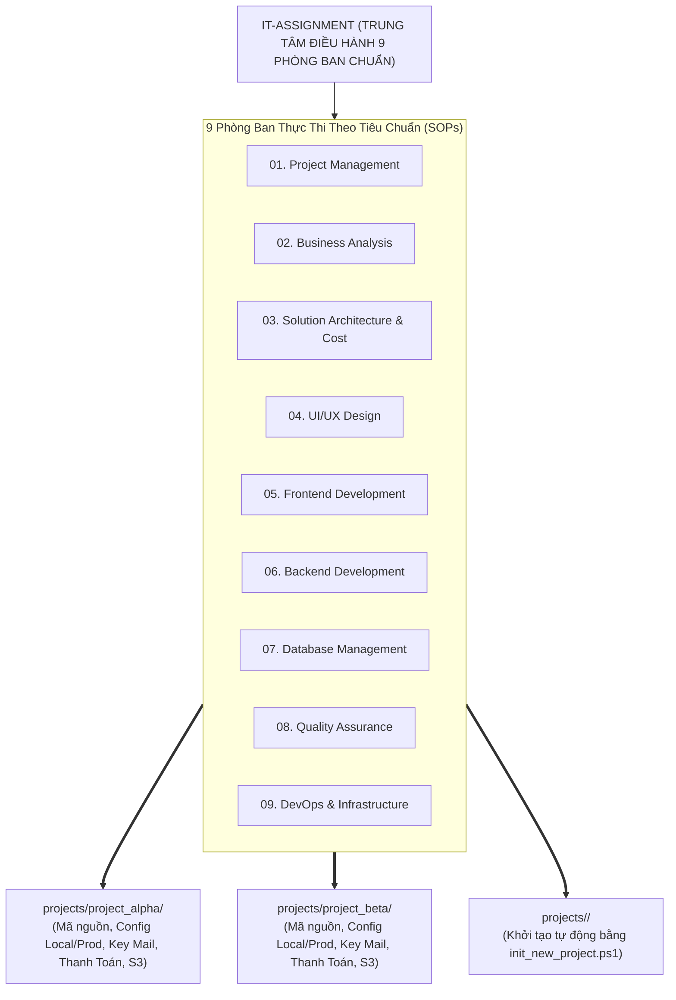

# HỆ ĐIỀU HÀNH 9 PHÒNG BAN & QUẢN TRỊ ĐA DỰ ÁN (ENTERPRISE OPERATING SYSTEM)

> **Kiến Trúc Phân Định 2 Tầng Rõ Ràng:**
> 1. **Tầng 1 - Bộ Khung 9 Phòng Ban Chuẩn Mực (`IT-Assignment`):** Là trung tâm điều hành tổ chức (Operating Hub / Corporate Governance). Chứa toàn bộ Quy chuẩn thực thi chuẩn (SOPs), Phương pháp luận, Tiêu chuẩn chất lượng, Ma trận RACI và Kỷ luật vận hành của 9 phòng ban. Tầng này được thiết kế để **phục vụ Đa Dự Án (Multi-Project)**, dùng lại cho bất kỳ dự án nào được đưa vào doanh nghiệp. Tuyệt đối không nhồi nhét mã nguồn cụ thể hay tạo folder thử nghiệm bừa bãi vào đây!
> 2. **Tầng 2 - Không Gian Dự Án Độc Lập ([`projects/`](./projects/)):** Mỗi dự án cụ thể khi ký kết sẽ được cấp một thư mục riêng biệt (Ví dụ: `projects/project_retail/`). Toàn bộ mã nguồn (FE/BE/DB), cấu hình Local vs Production (với đầy đủ các Key thực tế: Google Mail, Cổng thanh toán VietQR/VNPay/MoMo, Cloud Storage lưu hình ảnh S3/R2) được cô lập hoàn toàn trong thư mục của chính dự án đó!

---

## 🗺️ Bản Đồ Tổng Quan 9 Bộ Phận & Không Gian Dự Án

---

## 📁 Cấu Trúc Thư Mục Chuyên Biệt

| STT | Thư Mục | Bộ Phận / Vị Trí | Mục Tiêu Cốt Lõi | Sản Phẩm Bàn Giao Chính |
|---|---|---|---|---|
| **01** | [`01_Project_Management/`](./01_Project_Management/) | **Project Coordinator / TPM** | Task nguyên tử tiết kiệm 95% token, On-time, On-budget, công cụ may đo | Đề xuất chi phí, Chiến thuật Vibe Coding siêu tiết kiệm Token, WBS, Master Dashboard |
| **02** | [`02_Business_Analysis/`](./02_Business_Analysis/) | **Business Analyst (BA)** | Đúng bài toán người dùng, thấu hiểu chủ đề & mong muốn cốt lõi | Phân tích chiến lược (Thương hiệu/SEO/Giao diện), BRD, SRS, User Stories, BPMN |
| **03** | [`03_Solution_Architecture_Cost/`](./03_Solution_Architecture_Cost/) | **Solution Architect / Tech Lead** | Đúng công nghệ, tối ưu chi phí, chịu tải cao | SAD (Kiến trúc hệ thống), Cost Breakdown, ADR, Tech Risks |
| **04** | [`04_UI_UX_Design/`](./04_UI_UX_Design/) | **UI/UX Designer** | Bản sắc sáng tạo độc bản, kỷ luật màu sắc & typography, cuộn mượt 60fps | Design System, Figma Prototype, Tokens JSON, Kỷ luật thiết kế, Trải nghiệm cuộn |
| **05** | [`05_Frontend_Development/`](./05_Frontend_Development/) | **Frontend Developers** | Tái hiện pixel-perfect, tối ưu tốc độ mượt mà | Ứng dụng Web/Mobile, Atomic Components, Tích hợp API |
| **06** | [`06_Backend_Development/`](./06_Backend_Development/) | **Backend Developers** | Logic chuẩn xác, an toàn, xử lý đồng thời lớn | REST/gRPC APIs, Swagger/Postman, Worker Queues, Caching |
| **07** | [`07_Database_Management/`](./07_Database_Management/) | **Database Team / DBA** | Truy vấn siêu tốc, dọn rác định kỳ, kỷ luật Index chống phình đĩa, bảo mật chống SQLi | Cẩm nang Query tối ưu, Kỷ luật Index thép, Dọn rác Autovacuum, Backup WAL, RLS Security |
| **08** | [`08_Quality_Assurance/`](./08_Quality_Assurance/) | **QA / QC - Software Testers** | Kiểm thử từng bước sau triển khai, nhật ký PASS/FAIL, bảo mật input, test mock DB | Nhật ký tính năng PASS/FAIL, Ma trận bảo mật Input, Audit 5 chiều UI/UX, Mock DB Policy |
| **09** | [`09_DevOps_Infrastructure/`](./09_DevOps_Infrastructure/) | **DevOps / SysAdmin** | Server tối ưu chi phí, deploy an toàn zero-downtime, bảo mật keys, CI/CD đa nền tảng | Đề xuất Server FinOps, Blue-Green Deploy, Zero-Trust Secrets, .dockerignore, CI/CD đa nền tảng |
| **🖥️** | [`monitor_dashboard/`](./monitor_dashboard/) | **Web Giám Sát Tiến Độ** | Dashboard theo dõi tiến độ đa dự án, trực quan hóa luồng phối hợp 9 phòng ban | Web App `index.html`, Sơ đồ luồng SVG tương tác, Quản trị Task, Lịch sử Audit Trail |
| **📁** | [`projects/`](./projects/) | **Không Gian Đa Dự Án** | Tách biệt tuyệt đối từng dự án, chứa mã nguồn thực tế, config Local vs Prod | Khuôn mẫu dự án `_project_template/`, script khởi tạo `init_new_project.ps1` |

---

## 📊 Ma Trận Phân Định Trách Nhiệm (RACI Matrix)

* **R (Responsible):** Người trực tiếp thực hiện công việc.
* **A (Accountable):** Người chịu trách nhiệm phê duyệt cuối cùng (chỉ 1 người).
* **C (Consulted):** Người được tham vấn chuyên môn 2 chiều.
* **I (Informed):** Người được thông báo cập nhật kết quả.

| Giai Đoạn / Sản Phẩm | TPM (01) | BA (02) | SA (03) | UI/UX (04) | FE (05) | BE (06) | DBA (07) | QA (08) | DevOps (09) |
|---|:---:|:---:|:---:|:---:|:---:|:---:|:---:|:---:|:---:|
| **Khởi động dự án & Lập kế hoạch** | **A/R** | C | C | I | I | I | I | I | I |
| **Đặc tả yêu cầu (BRD / SRS)** | A | **R** | C | C | I | I | I | C | I |
| **Kiến trúc hệ thống & Bóc tách chi phí** | A | C | **R** | I | C | C | C | I | C |
| **Thiết kế UI/UX & Prototype** | A | C | I | **R** | C | I | I | C | I |
| **Thiết kế Cơ sở dữ liệu (ERD)** | I | C | A | I | I | C | **R** | I | I |
| **Phát triển Backend & APIs** | A | I | C | I | C | **R** | C | I | I |
| **Phát triển Frontend & Giao diện** | A | I | I | C | **R** | C | I | I | I |
| **Kiểm thử hệ thống & Nghiệm thu QA** | A | C | I | I | C | C | I | **R** | I |
| **Triển khai CI/CD & Vận hành Production** | A | I | C | I | I | I | C | I | **R** |

---

## 🔄 Luồng Phối Hợp & Handoff Giữa Các Phòng Ban (SLA & Handshake)

1. **Khách hàng ➔ BA (Khám phá chiến lược & Phân tích mong muốn) ➔ TPM:** 
   - BA tiến hành **Project Discovery**: Phân tích chủ đề ngành hàng, làm rõ mong muốn cốt lõi của khách hàng (Ưu tiên Thương hiệu độc bản, Giao diện thẩm mỹ, SEO thống trị Google, hay Tối ưu chuyển đổi đơn hàng) và nghiên cứu tâm lý người tiêu dùng (Consumer Intent).
   - BA chuyển hóa kỳ vọng kinh doanh thành tài liệu **BRD** và đặc tả kỹ thuật **SRS**.
   - TPM cùng BA xác định phạm vi (Scope) và tạo **WBS**.
2. **BA ➔ UI/UX & Solution Architect:**
   - UI/UX dựa vào User Story để dựng Wireframe và High-fidelity Mockup trên Figma.
   - Solution Architect thẩm định tính khả thi kỹ thuật, chọn Tech Stack và ước tính chi phí hạ tầng/nhân sự.
3. **UI/UX & SA ➔ Frontend, Backend & Database:**
   - Database Team chốt ERD và cung cấp Migration scripts.
   - Backend xây dựng nghiệp vụ, sinh tài liệu Swagger/OpenAPI.
   - Frontend lấy thiết kế Figma và API Swagger để ghép màn hình và xử lý trạng thái.
4. **Dev (FE/BE) ➔ QA/QC:**
   - Sau khi Dev pass Unit Test, DevOps build lên môi trường `Staging`.
   - QA chạy Functional, Non-functional, Cross-browser và Automation Regression Test.
5. **QA Sign-off ➔ DevOps ➔ Production:**
   - Khi không còn lỗi blocker/critical, QA ký biên bản nghiệm thu (QA Sign-off).
   - DevOps kích hoạt CI/CD deploy lên Production, bật giám sát cảnh báo và gửi báo cáo cho TPM.

---

## 🔁 Vòng Lặp Tiếp Nhận Phản Hồi Khách Hàng & Quản Trị Đa Dự Án

* **Điều Phối Đa Dự Án Độc Lập:** Bộ khung 9 phòng ban phục vụ đồng thời nhiều dự án (`projects/`) hoàn toàn độc lập, tách bạch cấu hình, context và dữ liệu.
* **Tiếp Nhận & Xử Lý Feedback Khách Hàng:**
  1. Khách hàng/Quản lý gửi phản hồi từ giao diện Website Quản Trị ([`monitor_dashboard/`](./monitor_dashboard/)).
  2. **01. Quản Trị Dự Án (PM)** là đơn vị duy nhất tiếp nhận, chủ trì thẩm định cùng SA & UI/UX để ban hành **Solution kỹ thuật chuẩn mực** (loại bỏ emoji tùy tiện, bám sát Brand Guideline của khách, tối ưu trải nghiệm).
  3. Bẻ nhỏ Solution thành các Task hạt nguyên tử điều phối xuống các phòng ban kỹ thuật liên quan.
* **Tiêu Chuẩn Web Động & Phân Tách Dữ Liệu:**
  * **Production:** Web Động Full-Stack kết nối 100% dữ liệu thật, cổng thanh toán VietQR thật, CDN lưu trữ đám mây tốc độ cao.
  * **Local / UAT / Sandbox:** Chạy 100% Mock Data trên môi trường test cô lập, bảo vệ tuyệt đối an toàn dữ liệu khách hàng.
* **Chi Tiết Quy Chuẩn Vận Hành Production & Phối Hợp Kỹ Thuật 9 Phòng Ban:** Xem văn bản chuẩn mực tại [`01_Project_Management/12_cross_department_production_readiness_and_admin_governance.md`](./01_Project_Management/12_cross_department_production_readiness_and_admin_governance.md).

